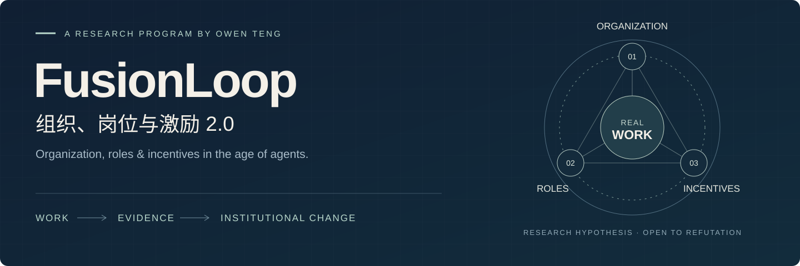

# FusionLoop — AI Agent 时代的组织设计、岗位与激励研究

<b>先重构工作，再依据真实运行结果重构组织、岗位与激励。</b>

  <a href="paper/README.md"><b>阅读完整论文 →</b></a> &nbsp; · &nbsp;
  <a href="https://github.com/Owen-Teng/fusionloop/releases/download/v0.3-reading/FusionLoop-Reading-Companion-v0.3.zip"><b>下载配套阅读包</b></a> &nbsp; · &nbsp;
  <a href="idea.zh-CN.md">理解核心假设</a> &nbsp; · &nbsp;
  <a href="README.en.md">English</a>

滕新阳 · Owen Teng &nbsp; / &nbsp; 37 页研究报告 &nbsp; / &nbsp; 2026 年 8 月外部审阅校订稿 研究证据截至 2026-08-21 · 开放研究假设，等待真实组织检验

---

## 当 Agent 承担执行，组织应当怎样改变？

如果信息、知识和执行能够围绕共享结果直接协同，人应该承担什么责任，岗位如何保留专业归属，组织又应该奖励什么？

**FusionLoop 是一套关于 AI Agent、人机协作与组织设计的研究材料。** 仓库提供 37 页中文完整论文、双语导读和工作画布，供管理者、HR 与研究者讨论工作设计、岗位权责和激励机制。 它从一项可验收的真实工作出发，把人类判断、Agent 执行、组织上下文和受控学习连接起来，再用运行证据检验组织、岗位与激励的变化。

| 组织 2.0 | 岗位 2.0 | 绩效与激励 2.0 |
| :--- | :--- | :--- |
| 稳定业务单元、选择性能力中心与动态结果团队协同运行。 | 正式权责与专业归属保持清晰，任务和能力围绕结果动态组合。 | 识别直接结果、经验证的复用贡献、人才成长与继任、Agent 与能力资产。 |
| [组织如何运行 →](docs/organization.zh-CN.md) | [岗位怎样演化 →](docs/roles.zh-CN.md) | [贡献如何得到回报 →](docs/incentives.zh-CN.md) |

## 一张图看懂研究架构

论文原图 4 · 第 14 页。能力中心为选择性安排；Loop Owner 在授权范围内承担集成责任，专业签署、否决权与正式人事权责仍有明确归属。

业务把意图转成结果，技术把结果要求转成可运行任务，HR 把工作变化转成组织制度。**三类编译协同**，才使技术能力进入真实工作。

## 从一个完整结果，到下一轮组织能力

**FusionLoop 是这套制度假设的工作承载单元。** 一位 Loop Owner 在 Sponsor 授权和人员容量内整合能力；Agent 承担可治理的执行，有权人员守住判断、承诺和验收；成功与失败经过审核、测试和版本控制，再进入下一轮。

| 想理解什么 | 从这里开始 |
| :--- | :--- |
| 为什么“信息沿层级接力”可能转向“围绕共享结果直接协同”？ | [核心假设与适用边界](idea.zh-CN.md) |
| 谁管结果、谁管人、谁有否决权？ | [六类责任角色与三类编译](docs/governance.zh-CN.md) |
| 20 / 10 / 70 究竟描述什么？ | [未来工作容量假设](docs/organization.zh-CN.md#capacity-hypothesis) |
| 一项工作如何具备完整责任与受控学习？ | [FusionLoop 的四项变化与十个要素](docs/fusionloop.zh-CN.md) |
| 知识怎样被第二个人用起来？ | [一环三轨五阶、P2C2L 与 VKM](docs/learning.zh-CN.md) |
| FridayOS、组织大脑与研究是什么关系？ | [内部 0→1 与可选的战略延展](docs/tooling.zh-CN.md) |

## 两个岗位，看到制度如何落到工作

| 客户解决方案 | 人才供给 |
| :--- | :--- |
| 从方案文档交付，走向**客户认可、内部可交付的完整方案责任**。 | 从获批需求，走向**按约到岗、完成正式交接、可以开始贡献**。 |
| 连接销售、产品、架构、报价、法务、安全与交付；明确承诺和专业判断的边界。 | 连接招聘、用人、薪酬、文化、员工体验与支持专业；明确录用判断和后续培养责任。 |
| [阅读设计示例 →](examples/customer-solution.zh-CN.md) | [阅读设计示例 →](examples/talent-supply.zh-CN.md) |

两者均为论文中的制度设计示例，尚不代表实施或效果证据。

## 把研究带入一次真实讨论

[十要素工作画布](templates/loop-canvas.zh-CN.md) · [组织权责约定](templates/governance-compact.zh-CN.md) · [周期证据记录](templates/cycle-record.zh-CN.md) · [贡献与复用记录](templates/contribution-record.zh-CN.md) · [P2C2L 知识转化记录](templates/knowledge-transfer.zh-CN.md)

这些是依据论文整理的可填写工具。先把结果、权责、验收和证据写清楚，再判断是否值得开展真实尝试。[查看验证与回退标准 →](evaluation.zh-CN.md)

## 配套阅读，把研究带走

**25 项精选材料，三条阅读路径：工作重构的证据与反例、组织治理、岗位与激励。**

阅读包包含完整论文、中文导览、三篇主题导读、五组双语模板，以及一份开放许可的 METR 原始研究。其他报告通过官方入口阅读，每一项都说明与研究的关系和适用边界。

[**下载阅读包 ZIP →**](https://github.com/Owen-Teng/fusionloop/releases/download/v0.3-reading/FusionLoop-Reading-Companion-v0.3.zip) &nbsp; · &nbsp; [浏览阅读资料区 →](reading/README.md) &nbsp; · &nbsp; [中文导览 PDF →](reading/research-companion.zh-CN.pdf)

## 研究状态与开放问题

原稿是 **2026 年 8 月的外部审阅校订稿**。FusionLoop 的组织效果、P2C2L 的跨人复用效果、FridayOS 2.0 的团队运行，均仍待验证。FridayOS 1.0 的个人使用记录不能外推为组织成效。

如果多个周期中，扣除复核、返工、维护成本后净结果没有改善，或质量、公平、人才延续与协作负担持续恶化，就应回退工作设计或修改假设。**能被反例修正，是这项研究的一部分。**

[37 页原始 PDF](paper/agent-era-organization-roles-incentives.zh-CN.pdf) · [逐页正文与原页图像](paper/full-text.zh-CN.md) · [原图索引](paper/figures.md) · [来源与引用](references.md) · [版本记录](CHANGELOG.md)

---

**滕新阳 · Owen Teng** &nbsp; 人力资源管理 · 产品建设 · 组织学习  
[关于作者](https://github.com/Owen-Teng) · [个人网站](https://tengxinyang.cn) · [提出问题或反例](https://github.com/Owen-Teng/fusionloop/issues) · [参与方式](CONTRIBUTING.md)

