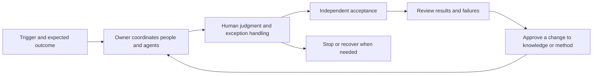

# FusionLoop

### Design work that people and agents can finish, review, and learn from.

[简体中文](README.zh-CN.md) · [The idea](idea.md) · [Work canvas](templates/loop-canvas.md) · [Worked example](examples/research-brief.md)

An agent can finish its task while the work remains unfinished. A report exists, but nobody has checked its claims. A recommendation is ready, but nobody owns the decision. A correction is made, but the next attempt repeats the mistake.

**FusionLoop is a proposed approach to organizing human–agent work around an accepted outcome, an accountable owner, explicit human judgment, and learning that reaches the next cycle.**

My starting proposition: **redesign the work, then use evidence from that work to reconsider roles, organization, and incentives.**

## Start with one piece of work

| Your question | Start here |
| --- | --- |
| What is the idea? | [Read the short argument](idea.md) |
| How would I apply it? | [Fill in a work canvas](templates/loop-canvas.md) |
| What does a finished example look like? | [Follow a public-research brief from question to revision](examples/research-brief.md) |
| Can my agent help me get started? | [Use the starter prompt](prompts/start-a-loop.md) |
| How will I know whether it helps? | [Define a comparison and record the result](evaluation.md) |

No software installation is needed. Begin with a recurring, bounded task whose result someone can actually accept or reject.

## The working model

**Roles hold accountability. Loops organize work. Skills capture reusable methods. Agents perform bounded actions. Evidence informs changes.**

An owner coordinates the whole outcome within an agreed mandate. Professional decisions remain with the people authorized to make them. An agent's self-assessment does not replace acceptance by the intended recipient.

## When the organization learns

Finishing one cycle creates an opportunity to learn. Learning becomes organizational capability when another person can reuse the approved knowledge or method, understand its limits, and correct it when circumstances change.

[Read: When one person learns, does the organization learn too?](essays/organizational-learning.md)

## Status and scope

**v0.1 · Research proposal and practice kit · 23 October 2026**

This release contains a method, templates, an agent prompt, and a constructed teaching example. It does not establish productivity gains or organizational effects. [Evaluation](evaluation.md) states what would count as useful evidence and what would weaken the proposal.

The initial scope is recurring knowledge work with reviewable outcomes. Start with a low-risk case. If an existing process already provides the same responsibilities, judgment points, recovery, acceptance, and learning, retain its name and improve it where necessary.

## About and participation

Developed by [Owen Teng](https://github.com/Owen-Teng), a management practitioner and AI product co-builder. FusionLoop is a method proposal; [FridayOS](https://github.com/Robinson-AI-Lab/FridayOS1.0) is a separate product exploration with collaborators at [Robinson AI Lab](https://github.com/Robinson-AI-Lab).

Useful feedback includes an unclear definition, an unnecessary step, a counterexample, or a real attempt that failed. [How to contribute](CONTRIBUTING.md) · [References and attribution](references.md) · [Changes](CHANGELOG.md)
