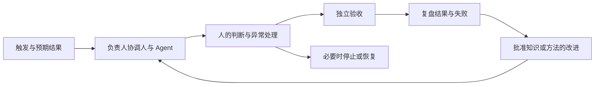

# FusionLoop

### 让人和 Agent 共同完成工作，让经验进入下一轮。

[English](README.md) · [核心理念](idea.zh-CN.md) · [工作画布](templates/loop-canvas.zh-CN.md) · [完整示例](examples/research-brief.zh-CN.md)

Agent 完成了任务，工作却可能还没有完成：报告生成了，关键判断没有核实；建议写好了，没人对最后的决定负责；错误改过了，下次仍然重犯。

**FusionLoop 是一种人机工作组织方法的提案：围绕一个可验收的结果，明确负责人、人的判断、Agent 的执行边界，以及经验怎样改变下一轮工作。**

我的出发点是：**先重构工作，再依据真实运行证据调整岗位、组织与激励。**

## 从一项具体工作开始

| 你想了解什么 | 从这里进入 |
| --- | --- |
| 这个理念是什么？ | [读核心论述](idea.zh-CN.md) |
| 怎样用于我的工作？ | [填写一张工作画布](templates/loop-canvas.zh-CN.md) |
| 完整做出来是什么样？ | [看一份研究简报怎样形成、被退回和修订](examples/research-brief.zh-CN.md) |
| 能让我的 Agent 帮我开始吗？ | [使用启动提示词](prompts/start-a-loop.zh-CN.md) |
| 怎样知道它有没有价值？ | [设计比较并记录结果](evaluation.zh-CN.md) |

无需安装软件。先选一项经常发生、边界清楚、有人能够接受或退回结果的工作。

## 工作怎样形成闭环

**岗位承责，Loop 承事，Skill 沉淀方法，Agent 承接执行，Evidence 支持修订。**

Loop Owner 在约定的授权范围内协调完整结果。专业判断仍由有权作出判断的人承担。Agent 自己说“已完成”，不能代替成果接收者的验收。

## 组织怎样同时学会

完成一次工作，产生了一次学习机会。当另一个人能够复用已经审查的知识或方法，理解适用边界，并在情况变化时纠正它，经验才开始成为组织能力。

[继续读：一个人学会以后，组织怎样也能学会？](essays/organizational-learning.zh-CN.md)

## 当前阶段与适用范围

**v0.1 · 研究提案与实践工具包 · 2026 年 10 月 23 日**

本版包含方法、模板、Agent 提示词和构造的教学示例，尚不构成效率提升或组织效果的验证。[验证方法](evaluation.zh-CN.md)列出哪些证据支持继续采用，哪些结果会削弱这个提案。

初始范围是结果可检查、会重复发生的知识工作。先从低风险场景开始。已有流程如果已经具备相同的责任、判断、恢复、验收和学习机制，就沿用其名称，按实际需要改进。

## 作者与参与

提出者：[滕新阳 Owen Teng](https://github.com/Owen-Teng)，管理实践者、AI 产品共创者。FusionLoop 是方法提案；[FridayOS](https://github.com/Robinson-AI-Lab/FridayOS1.0) 是与[鲁滨逊实验室](https://github.com/Robinson-AI-Lab)伙伴共同开展的产品探索。

欢迎指出难懂的定义、多余的步骤、反例，以及没有成功的真实尝试。[参与方式](CONTRIBUTING.md) · [参考与归属](references.md) · [版本变化](CHANGELOG.md)
