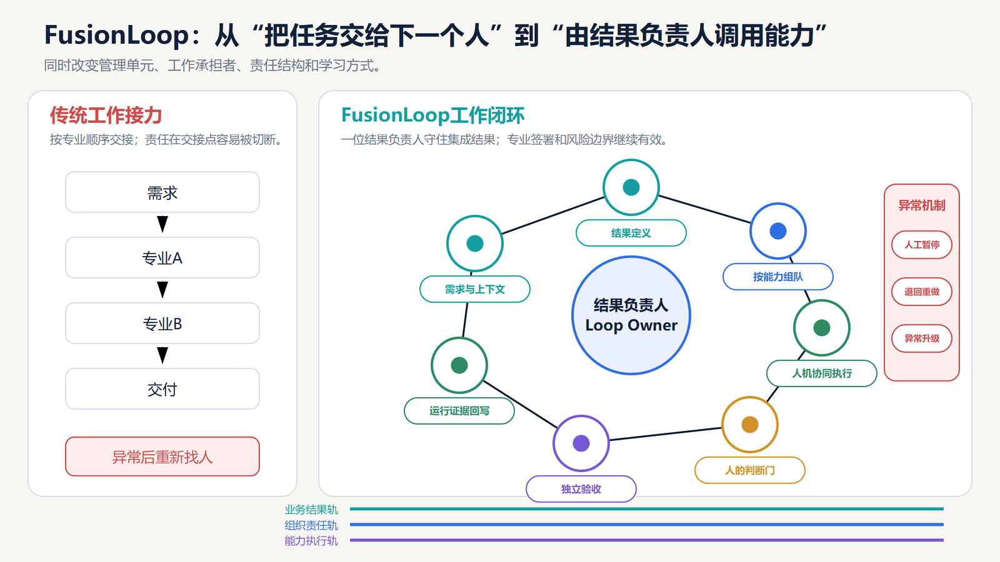

# FusionLoop: complete outcomes and controlled evolution

[Home](../README.en.md) · [Full paper](../paper/README.md) · [中文](fusionloop.zh-CN.md)

> Reading guide | Editorial adaptation of the source paper, pp. 24–27. This is not new empirical evidence. The Chinese original governs interpretation.

## Definition

FusionLoop is a work-organization principle beginning with an accepted business outcome. One Loop Owner integrates the end-to-end result within Sponsor delegation and allocated capacity, coordinating experts and calling organizational context, Skills, agents and business systems. Agents perform governable routine execution; consequential judgments, exceptions and high-risk matters return to Gatekeepers or other authorized people. Results, failures and proposed fixes enter the next cycle through review, testing and version control. This is an editorial translation of the definition on p. 24.

“Fusion” combines human judgment, agents, context, methods and systems. “Loop” means repeated work with controlled learning.

## Four changes together

1. **Management unit:** from segmented steps to a complete, accepted outcome.
2. **Execution:** from people alone to people and agents.
3. **Accountability:** one integrating Owner, with professional sign-off, vetoes and risk responsibilities retained.
4. **Evolution:** operating evidence updates context, Skills, agents, work allocation and institutional rules, then tests them in the next real cycle.

## Ten elements of a Loop

| Element | Question |
| --- | --- |
| Trigger | What starts the work? |
| Business outcome | What complete outcome is delivered, and to whom? |
| Loop Owner | Who integrates end to end? |
| Input context | Which sources, rules, states, permissions and versions apply? |
| Human responsibilities | Who judges, commits, signs and takes over? |
| Agent execution scope | Which actions are authorized, within what limits? |
| Judgment gates | Where must an authorized person decide? |
| Exception escalation | Who handles deviations in rules, authority or quality? |
| Acceptance criteria | Who accepts what evidence? |
| Outcome writeback | What becomes next-cycle knowledge, and who reviews, tests and publishes it? |

## Controlled evolution

**Real operation and failures → problem evaluation → proposed repair → authorized review and testing → version release → next-cycle verification.**

“Evolution” does not authorize unattended changes to official code, rules, permissions or models. Repairs must cross human judgment gates, testing, release and subsequent verification. Failures remain part of the record.

## Relationship to existing methods

Processes, projects, agile teams and BPM already include accountability, quality and continuous improvement. The proposed additions are formal, versioned capability assets with provenance, permissions and maintainers; evidence-based recomposition of human–agent work; and feedback into roles, capacity, evaluation, incentives and organizational capability.

If an existing BPM system already implements these mechanisms, it need not be rebuilt or renamed. Agent orchestration alone does not automatically meet institutional requirements.

## Suitable work

Start with clear triggers, mature acceptance standards, recordable inputs, repeated handoff delays, sufficient frequency and rollback options. Recruiting, employee services, finance, procurement, bids, sales operations and support are candidate domains. High-trust relationships, negotiations, crises and consequential personnel judgments retain human responsibility.

[Ten-element canvas](../templates/loop-canvas.md) · [Organizational twin maps](roles.md)
