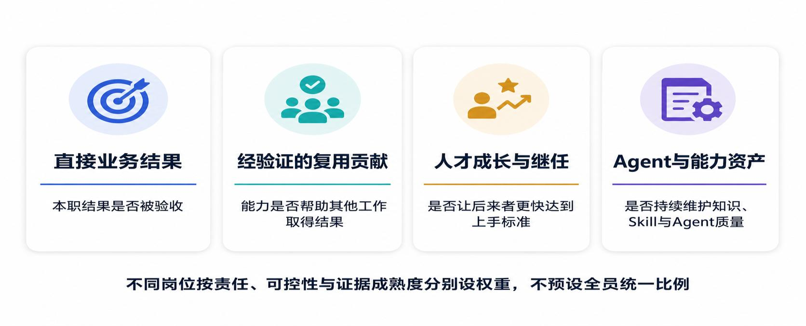

# Performance and incentives 2.0: making contributions recognizable

[Home](../README.en.md) · [Full paper](../paper/README.md) · [中文](incentives.zh-CN.md)

> Reading guide | Editorial adaptation of the source paper, pp. 21–24. This is not new empirical evidence. The Chinese original governs interpretation.

The outcome axis considers accepted value, quality, cycle time, cost and risk. The process/capability axis considers evidence, independent reuse, next-cycle costs, people and asset maintenance. Quality, safety, compliance, reliability and customer harm are gates, not points that other scores can offset.

## Four contributions, different recognition times

| Contribution | When evidence is sufficient | Possible recognition |
| --- | --- | --- |
| Direct business results | Acceptance plus necessary quality/customer-impact observation | Team/project rewards, annual variable pay, immediate recognition |
| Verified cross-team reuse | Actual adoption and results by a second person, cycle or team, net of review, rework and maintenance | Specific rewards, promotion, grade progression, long-term incentives |
| Talent development and succession | A newcomer or successor reaches agreed independent-handover standards | Manager evaluation, talent review, promotion and development opportunities |
| Agent and capability assets | Others can maintain the agent, Skill or method and obtain stable real-work results | Specific recognition, platform/expert evaluation, promotion or long-term incentives |

These are institutional options in the paper, not a universal bonus formula. Base pay and grades recognize stable role value; different contributions require different timing and mechanisms.

## Prevent double counting and metric gaming

**Count an adoption result once under reuse; the asset dimension recognizes continuing maintenance, correction, reliability, handover and version governance.** Multiple professions collaborating within one Loop is not itself cross-Loop reuse. Uploads, calls, agent counts, courses and learning hours cannot substitute for outcomes.

Owners emphasize direct results; Gatekeepers emphasize quality and independent judgment; platform/capability roles emphasize reuse, reliability and succession. Weights depend on role responsibility, outcome controllability and evidence maturity. Unverifiable reuse or metric gaming should prevent that dimension from entering formal incentives.

## Development means becoming able to take over

Progress moves from acquiring context, to independently doing standard work and escalating exceptions, to building capabilities for the next person. An important signal is **time for a newcomer or successor to reach independent-handover standards**.

Authorized managers retain formal evaluation. Operating evidence supplies facts. Major quality/risk events may trigger deferral, deductions or recovery under established rules after fact-finding, accountability and appeals; an agent cannot automatically issue personnel judgments.

[Contribution record](../templates/contribution-record.md) · [Authority and appeals](governance.md)
