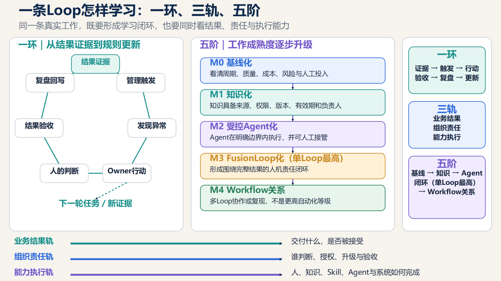

# 学习机制：一环三轨五阶、P2C2L 与 VKM

[研究首页](../README.md) · [完整论文](../paper/README.md) · [English](learning.md)

> 论文导读｜依据原稿第 27–30 页整理；为便于网页阅读而重组，不是新增实证结果。

组织能力的关键不是文档数量，而是知识能否以可信、授权、可调用、可更新的方式回到真实工作。

## 一环：回到下一轮真实结果

**运行证据 → 触发 → 行动 → 人的判断 → 验收 → 复盘与修复 → 审核测试 → 版本更新 → 下一轮。**

成功与失败都进入记录。学习完成的判断不是“写了一篇复盘”，而是经过审核的变化能在下一轮工作再次被检验。

## 三轨：同时看结果、责任与执行

| 轨道 | 观察问题 |
| --- | --- |
| 业务结果轨 | 最终交付了什么，是否被客户或内部对象接受？ |
| 组织责任轨 | 谁负责、判断、审批和处理异常？ |
| 能力执行轨 | 人、知识、Skill、Agent 和系统怎样共同完成？ |

只有系统日志没有业务结果，无法判断价值；只有最终结果没有运行轨迹，无法区分改善来自责任澄清、工作重构还是 Agent。

## 五阶：M4 评价关系，不评价单环自动化

| 阶段 | 必要变化 |
| --- | --- |
| M0 · 基线化 | 记录周期、质量、成本、风险和人工投入 |
| M1 · 知识化 | 知识具备来源、负责人、权限、版本与有效期 |
| M2 · 受控 Agent 化 | Agent 在明确范围内执行，保留判断门和人工接管 |
| M3 · FusionLoop 化 | 一条 Loop 形成完整结果的人机责任闭环 |
| M4 · Workflow 关系 | 至少两条 M3 Loop 通过治理接口协同，在跨负责人、跨团队或第二场景中形成可验收的整体结果 |

**M3 是单条 Loop 的最高阶段；M4 是成熟 Loop 之间的关系资格，不是更高的自动化百分比。**

## P2C2L：个人知识 → 组织上下文 → 业务 Loop

这是作者提出、等待团队运行检验的方法。知识进入组织要经过五道门：

1. 个人选择与授权：本人决定哪些经验可以进入何种用途。
2. 来源、权限、版本、有效期治理：建立可回溯的上下文。
3. 适用工作与结果：明确知识要帮助完成什么工作。
4. 他人独立采用与验收：由非原作者使用并检验结果。
5. 持续复用后正式化：沉淀为正式知识、规则或 Skill。

上传知识只是输入。第二个人能独立获得结果，才有组织能力的初步证据；持续复用还须观察复核、返工和维护成本。

## VKM：AI 辅助知识管理

Vibe Knowledge Management 是作者借鉴 Vibe Coding 交互方式提出的概念，尚不是已确立的学术或行业标准。人表达经验、条件与边界，AI 协助捕捉、整理、分类、关联、去重、格式化、提醒、检索与引用，组织负责审核、授权和发布。

**VKM 降低参与成本，P2C2L 守住转化门槛，FusionLoop 用真实工作检验价值。** 真实性、敏感性、权限和正式发布仍由有权人员判断。

员工保留知情、查阅、更正和申诉权。个人知识遵循最小必要、明确授权与用途限制；运行记录不能直接变成员工监控或自动人事结论。

[P2C2L 转化记录](../templates/knowledge-transfer.zh-CN.md) · [周期证据记录](../templates/cycle-record.zh-CN.md)
