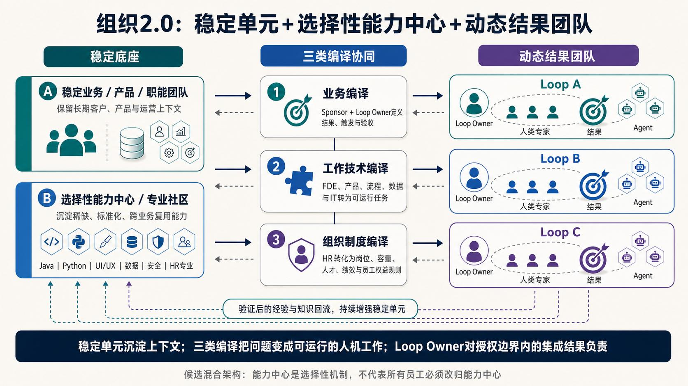
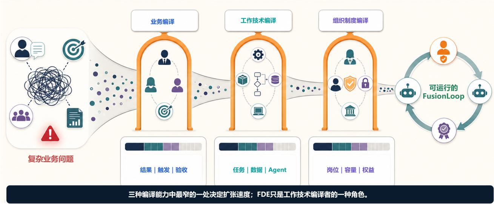
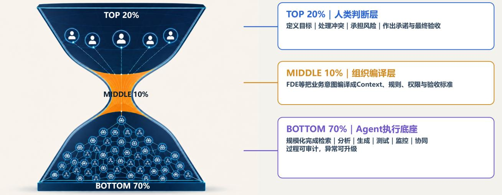

# 组织 2.0：稳定归属与动态结果

[研究首页](../README.md) · [完整论文](../paper/README.md) · [English](organization.md)

> 论文导读｜依据原稿第 14–17 页整理；为便于网页阅读而重组，不是新增实证结果。

## 混合架构

**稳定业务／产品／职能团队 + 选择性能力中心或专业社区 + 动态结果团队。** 三者之间通过业务、工作技术、组织制度三类编译协同运行。

稳定单元保留长期客户关系、产品架构、持续运营和强业务上下文。稀缺、标准化、可跨业务复用的能力可以进入能力中心或专业社区；这不要求把所有员工抽离原部门。能力中心可由现有部门升级，也可跨部门形成。

## 能力中心交付什么

| 产出 | 应承担的责任 |
| --- | --- |
| 人才 | 人员能力、培养、继任、职业发展、负荷与专业梯队 |
| 能力资产 | 专业标准、知识、案例、Skill、Agent、工具和可供结果团队调用的方法 |

Line Manager 对人才成长和能力资产供给负责。价值取决于结果团队能否有效使用这些能力，不能以知识上传量或 Agent 数量代替。

## 动态结果团队如何成立

一个清楚的业务结果、一位得到任命的 Loop Owner、可调用的能力与明确容量、保留独立性的判断门、冲突升级机制和退出条件，共同构成可运行的结果团队。临时拉群不等于完成这些设计。

正式归属与动态结果形成两条管理线；人员时间冲突由 Sponsor 仲裁，跨 Sponsor 的重大冲突交由既有经营管理机制处理。详见[治理角色](governance.zh-CN.md)。

## 三类编译是潜在扩张瓶颈

业务编译明确结果、触发和验收；工作技术编译形成任务、数据和可执行能力；组织制度编译把变化纳入岗位、容量、人才、激励和员工权益。三者在运行中反复迭代。**最窄的一层可能决定扩张速度**，是待检验的管理假设，不是线性审批流程。

## 20 / 10 / 70：未来工作容量假设

| 容量设想 | 工作内容 |
| --- | --- |
| 上部 20%：人类判断 | 方向、价值取舍、客户信任、复杂判断、承诺与最终验收 |
| 中部 10%：组织编译 | 业务、技术、组织制度三类编译与治理，把意图、上下文、规则和权限转为可执行工作 |
| 下部 70%：Agent 执行 | 检索、分析、生成、测试、监测、协调和其他可审计执行 |

**分母是目标 Loop 组合的有效工作容量；不是员工人数、FTE 折算、编制方案或裁员目标。** 同一人可以同时贡献判断容量与编译容量；实际比例须随任务、风险和成熟度验证，不能视为固定标准。

中间层可能成为首条 Loop 成立的瓶颈；已经验证的知识、方法和 Agent 能否复用，关系到后续扩张。探索期先由少量授权团队建立规则；扩张期增加复用与协同；成熟期才探索受控的新建、运行、复盘和退出。
