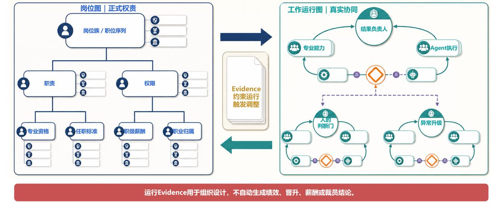

# Roles 2.0: the formal-role map and the work-operation map

[Home](../README.en.md) · [Full paper](../paper/README.md) · [中文](roles.zh-CN.md)

> Reading guide | Editorial adaptation of the source paper, pp. 17–21. This is not new empirical evidence. The Chinese original governs interpretation.

Formal roles continue to carry employment relationships, responsibilities, authority, qualifications, grades, compensation, professional homes and legal/risk accountability. Roles may be recombined, merged, created or retired when evidence across real work cycles warrants it.

## Two maps that test one another

| Formal-role map | Work-operation map |
| --- | --- |
| What formal responsibility and authority does this person hold? | How is a real outcome delivered? |
| Qualifications, grade, compensation, professional home and career path | Human judgments, agent execution and capability flows |
| Authorizes real work | Supplies evidence for changes to roles and institutions |

Together they form **organizational twin maps**. First establish whether work has changed sustainably, then consider responsibilities, capability standards, grade, staffing and performance rules. A single map, successful cycle or average AI productivity estimate cannot justify personnel conclusions.

## What a role description should add

- The complete business outcome and upstream/downstream boundaries.
- Non-delegable judgments, commitments, sign-offs and exceptions.
- Callable capabilities and their authority/capacity limits.
- Knowledge, Skills, agents and methods to maintain and pass on.

Not every activity needs a Loop. Repeated triggers, accepted outcomes and feedback learning make work suitable for a FusionLoop map. High-trust relationships, complex negotiations, crises and consequential personnel decisions continue to require human-facing responsibility.

## Two design examples

[Customer solution](../examples/customer-solution.md) moves from document integration to complete solution accountability. [Talent supply](../examples/talent-supply.md) separates approved demand and arrival/handover from subsequent development. These illustrate designs, not implemented role changes.
