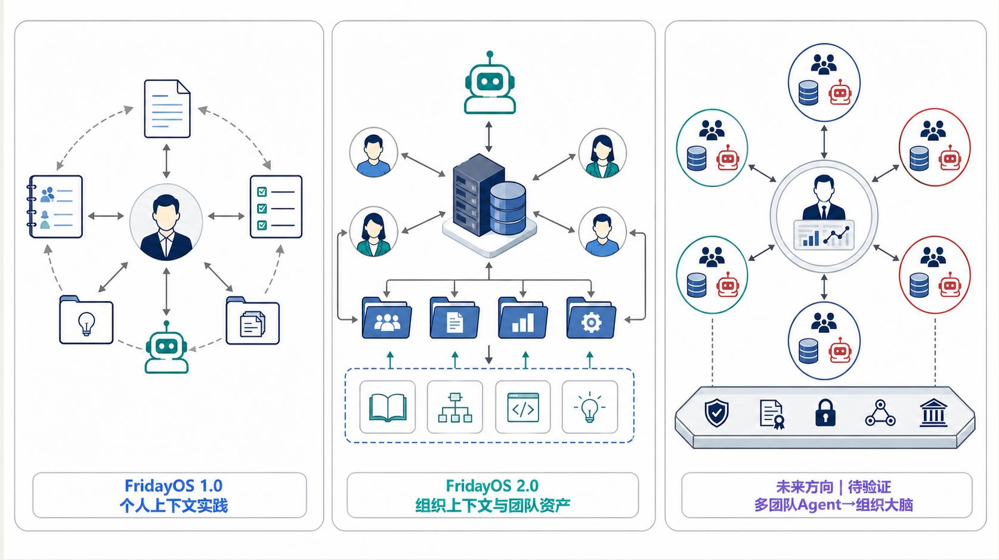
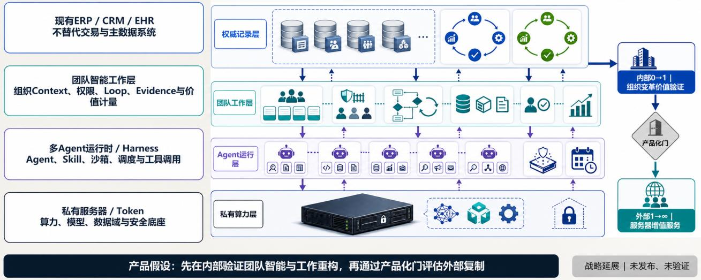

# Technical carriers: internal 0→1 and an optional strategic extension

[Home](../README.en.md) · [Full paper](../paper/README.md) · [中文](tooling.zh-CN.md)

> Reading guide | Editorial adaptation of the source paper, pp. 30–36. This is not new empirical evidence. The Chinese original governs interpretation.

FusionLoop is a work-organization principle; P2C2L is a knowledge-transfer method; FridayOS is a technical attempt to support them. FridayOS is not required for FusionLoop, and personal use does not validate the organizational hypothesis. Equivalent tools may carry the same methods.

## Status at the paper's date

These are August 2026 source statements. Publishing this web edition does not update product-validation dates.

| Object | State reported by the paper | Evidence still missing |
| --- | --- | --- |
| FridayOS 1.0 | Author-reported continuing personal use with retrievable, updateable, traceable and reusable personal work assets | Independent evaluation; team or organizational outcomes |
| FridayOS 2.0 | Team-intelligence architecture, methods and technical-path experiments | Real multi-user operation, non-author takeover and independent acceptance |
| Company brain | Future connection of team agents and real Loops to aggregate outcomes, failures, risks and experience | Organizational cognition, learning and decision effects |
| Team intelligence work layer | Candidate product layer between infrastructure and existing business systems | Demand, willingness to pay, delivery reuse and unit economics after internal validation |

## Five parts of the FridayOS 2.0 candidate architecture

A shared team agent/workspace maintains tasks and state. An organizational context hub governs sources, permissions, versions and expiry. A controlled connection network reaches personal folders, cloud knowledge, business systems, local nodes and isolated environments. A control/approval plane manages assignments, progress, exceptions and human decisions. Knowledge governance and Loop operations handle publication, quality, cycle time, reuse, conflict and risk.

Members retain separate identities. The team agent reads authorized team context and shared personal content; sensitive information may remain local or isolated. Exceptions should reach the person with both capability and authority.

## The internal 0→1 criterion

**A real work cycle can be taken over by someone other than its author, independently accepted, and continuously improved through controlled reuse of successes and failures.**

HR defines handover standards, development paths, thresholds for role changes and the limits of operating evidence in formal performance. Architecture, tool connectivity or a demo alone does not satisfy the criterion.

## Optional: a server-native team intelligence work layer

The paper proposes five capabilities above compute/model/data infrastructure and between existing ERP, CRM and EHR systems: Loop/team workspaces, organizational context, agent execution, governance/evaluation and open connections. Existing systems retain transactions, master data and official records.

Native pre-integration must demonstrate measurable advantages in private deployment, identity/permissions, inference cost, security audit, unified operations and total cost of ownership. Compatibility, permissions and implementation costs require individual validation.

Reusable assets may include industry Loop packages, validated Skills/agents, connectors, context/approval templates, evaluations/failure examples, operations/governance and replication methods. Falling delivery costs for a second Loop, team and customer are critical signals.

**This 1→∞ extension is conditional on internal 0→1 and a productization gate.** It is neither a required research outcome nor a second project launched alongside internal transformation. If every client needs newly designed data, permissions, processes and interfaces, value remains primarily bespoke consulting and delivery.
