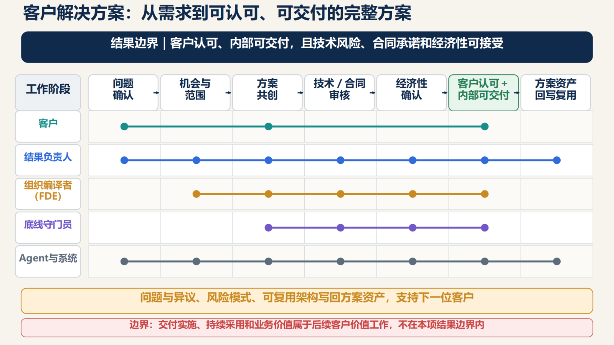

# Design example: customer solution

[Home](../README.en.md) · [Full paper](../paper/README.md) · [中文](customer-solution.zh-CN.md)

> Reading guide | Editorial adaptation of the source paper, pp. 18–19. This is not new empirical evidence. The Chinese original governs interpretation.

**Status: an institutional design example in the paper, not an implementation or impact report.**

## Outcome boundary

Start with a valid customer problem or qualified opportunity. Finish with **a customer-accepted, internally deliverable solution whose technical risks, contractual commitments and economics are acceptable**. A finished proposal document is an intermediate artifact.

| Element | Source design |
| --- | --- |
| Loop Owner | Customer-solution outcome owner, accountable for integration |
| Capabilities | Sales/industry insight, product, architecture, pricing, legal, security, delivery and partners |
| Agent tasks | Prior-solution retrieval, requirement synthesis, drafts, consistency checks, risk lists, version control |
| Human judgments | Customer commitments, price exceptions, feasibility, security/compliance, contractual duties and delivery commitments |
| Acceptance | Customer acceptance plus internal professional/delivery feasibility; professional sign-off and vetoes remain |
| Writeback | Customer objections, failures, reusable architecture, risk patterns and delivery deviations |

Formal roles retain professional sign-off and business responsibility. The solution role evolves from document integrator to complete-outcome integrator. Expert experience may become rules, standard methods and specialist agents, freeing expertise for exceptions and consequential judgments.

## Do not extend responsibility indefinitely

Implementation, continuing adoption and realized business value belong to a downstream customer-value Loop with its own Owner. Agree on handover evidence and recipient. Downstream feedback can test solution quality without assigning every later result to the solution Owner.

## What a real design still needs

The paper supplies no specific client, named people, system permissions, capacity allocation, numeric acceptance thresholds or operating data. A real [ten-element canvas](../templates/loop-canvas.md) requires authorized participants to fill in context, Sponsor delegation, escalation, independent acceptance and rollback. This example is not execution authorization.
