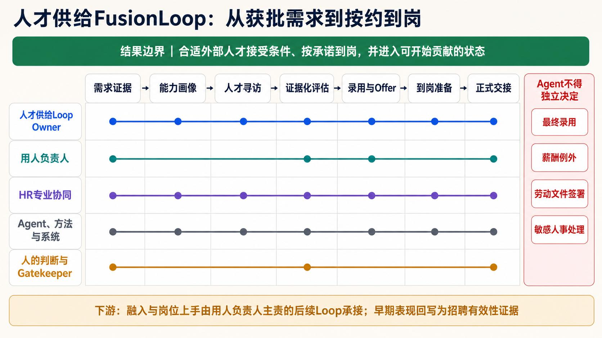

# Design example: talent supply

[Home](../README.en.md) · [Full paper](../paper/README.md) · [中文](talent-supply.zh-CN.md)

> Reading guide | Editorial adaptation of the source paper, pp. 20–21. This is not new empirical evidence. The Chinese original governs interpretation.

**Status: an institutional design example in the paper, not an implementation or impact report.**

## Outcome boundary

Start with demand approved under business and staffing rules. Finish when **suitable external talent accepts the terms, arrives as promised, is formally handed over to the hiring team and is ready to begin contributing**. Screening, interviewing and issuing an offer are not standalone end outcomes.

| Element | Source design |
| --- | --- |
| Loop Owner | Talent-supply outcome owner |
| Professions | Recruiting, hiring management, compensation, culture, employee experience, legal and IT |
| Agent tasks | Market scanning, candidate search/matching, scheduling, material checks, risk flags and progress tracking |
| Human judgments | Demand legitimacy, final selection, pay exceptions, privacy, fairness, employment commitments and handover |
| Acceptance | Agreed arrival, formal receipt by the hiring team and readiness to begin contributing |
| Writeback | Channel quality, profile bias, interview validity, offer acceptance/refusal reasons, arrival and early performance |

Agents cannot independently decide final selection, pay exceptions, employment signatures or sensitive personnel matters. The hiring manager retains demand responsibility, final selection and receipt.

## Separate downstream development

Onboarding, development and role readiness belong to a subsequent Loop owned by hiring management. Early performance can inform recruiting validity without attributing all later performance causally to recruiting.

## Distinguish collaboration from cross-Loop reuse

Multiple professions collaborating inside one talent-supply Loop do not automatically establish cross-team reuse. A culture-communication method used in both recruiting and an independently operated onboarding process, with accepted results, could support cross-work reuse evidence.

The paper specifies no real candidates, automated selection criteria, system permissions or measured effects. Real use requires a [ten-element canvas](../templates/loop-canvas.md), [governance compact](../templates/governance-compact.md) and [contribution record](../templates/contribution-record.md).
