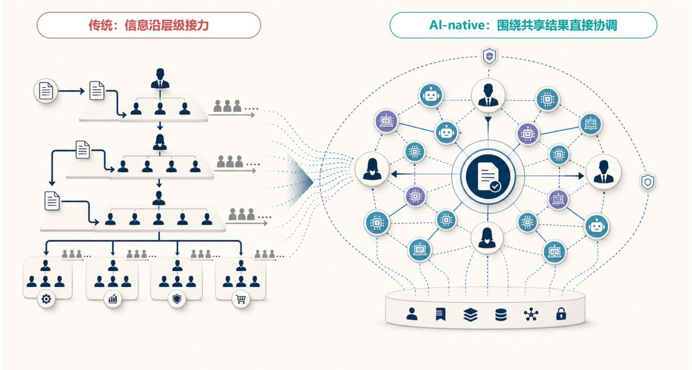

# Core hypothesis: from information relay to shared outcomes

[Home](README.en.md) · [Full paper](paper/README.md) · [中文](idea.zh-CN.md)

> Reading guide | Editorial adaptation of the source paper, pp. 4–13, 35–36. This is not new empirical evidence. The Chinese original governs interpretation.

## The proposition

**Redesign work. Let real operating results reshape organization, roles and incentives.**

Agents may change the medium of organizational coordination. Within clearly bounded work, shared outcomes, organizational context, permissions and operating evidence may support direct human–agent collaboration where people previously relayed information through hierarchies. This is the author's **organizational hypothesis**, not a validated organizational outcome.

Source pp. 12–13. An author hypothesis, not an implemented organizational model at a particular company.

## From hypothesis to institutions

1. **Organization 2.0:** stable business/product/function units retain long-term context; selective capability centers or professional communities build reusable capabilities; dynamic teams assemble around complete outcomes. Business, technology and HR perform three kinds of compilation.
2. **Roles 2.0:** formal roles retain authority, qualifications, grade, compensation and professional homes. A work-operation map shows actual tasks, human judgment and agent execution. Evidence across cycles informs changes to the formal role system.
3. **Performance and incentives 2.0:** distinguish direct results, verified cross-team reuse, talent development/succession and agent/capability assets. Evaluation methods and timing depend on responsibility, controllability and evidence maturity.

**FusionLoop carries real work; one cycle, three tracks and five stages organize learning; P2C2L and VKM govern knowledge transfer; FridayOS is one possible technical carrier.** These occupy different layers and do not validate one another.

## Why complete accountability matters

Delegating information processing and execution does not automatically create organizational capability. A Sponsor, end-to-end Loop Owner, capability supply, protected professional judgment, independent acceptance, escalation and controlled writeback remain necessary. A Loop can learn cyclically; it cannot grant itself governing authority.

FusionLoop requires four changes together: manage a complete outcome; combine human and agent execution; integrate under one Owner while retaining professional vetoes; and use operating evidence to update rules and capabilities through review. A circular diagram or an added agent alone does not meet this definition.

## What the external evidence supports

The paper connects research on work redesign, human–agent collaboration, institutional governance and capability platforms. It also limits the inference: task productivity cannot directly establish job removal, departmental downsizing or organizational value. Predictions, corporate disclosures, individual internal cases and independent studies remain distinct.

The author reports a research base of 35 core materials totaling 1,415 pages, 156 source entries (133 public), 18 company cases and two expert-conversation series. These describe the research process. This repository contains the **37-page paper and its 14 listed principal public sources**, not the entire underlying collection or expert records.

## What could refute it

Owner overload, competing bosses, increased review/maintenance cost, metric gaming, damaged employee trust and professional skill erosion could undermine the design. If net outcomes and institutional quality fail to improve over multiple cycles, stop expansion, roll back the design or revise the hypothesis.

[Original argument](paper/full-text.zh-CN.md#page-04) · [Organization design](docs/organization.md) · [Evaluation and counterexamples](evaluation.md)
