# Agent 时代下组织、岗位与激励 · 逐页检索正文

[研究首页](../README.md) · [阅读指南](README.md) · [原始 PDF](agent-era-organization-roles-incentives.zh-CN.pdf)

> 滕新阳，2026 年 8 月，外部审阅校订稿。研究证据截至 2026-08-21。以下为原稿逐页文字提取，保留原文与页码，未把假设改写为结果。表格、分栏和图中嵌入文字可能无法保持阅读顺序；每页均可展开原页图像核对，原始 PDF 为排版与内容依据。网页导读与工具另行标明为编辑整理。

[p.01](#page-01) [p.02](#page-02) [p.03](#page-03) [p.04](#page-04) [p.05](#page-05) [p.06](#page-06) [p.07](#page-07) [p.08](#page-08) [p.09](#page-09) [p.10](#page-10) [p.11](#page-11) [p.12](#page-12) [p.13](#page-13) [p.14](#page-14) [p.15](#page-15) [p.16](#page-16) [p.17](#page-17) [p.18](#page-18) [p.19](#page-19) [p.20](#page-20) [p.21](#page-21) [p.22](#page-22) [p.23](#page-23) [p.24](#page-24) [p.25](#page-25) [p.26](#page-26) [p.27](#page-27) [p.28](#page-28) [p.29](#page-29) [p.30](#page-30) [p.31](#page-31) [p.32](#page-32) [p.33](#page-33) [p.34](#page-34) [p.35](#page-35) [p.36](#page-36) [p.37](#page-37)

<a id="page-01"></a>

## 第 1 页

[打开本页原图](pages/page-01.png) · [原始 PDF，第 1 页](agent-era-organization-roles-incentives.zh-CN.pdf#page=1)

<details>
<summary>展开原页图文排版</summary>

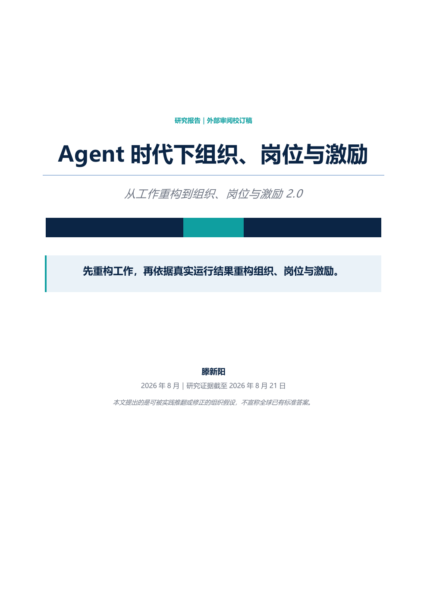

</details>

```text
研究报告｜外部审阅校订稿

Agent 时代下组织、岗位与激励

      从工作重构到组织、岗位与激励2.0


  先重构工作，再依据真实运行结果重构组织、岗位与激励。


                  滕新阳

                     2026 年8 月｜研究证据截至2026 年8 月21 日

         本文提出的是可被实践推翻或修正的组织假设，不宣称全球已有标准答案。
```

<a id="page-02"></a>

## 第 2 页

[打开本页原图](pages/page-02.png) · [原始 PDF，第 2 页](agent-era-organization-roles-incentives.zh-CN.pdf#page=2)

<details>
<summary>展开原页图文排版</summary>

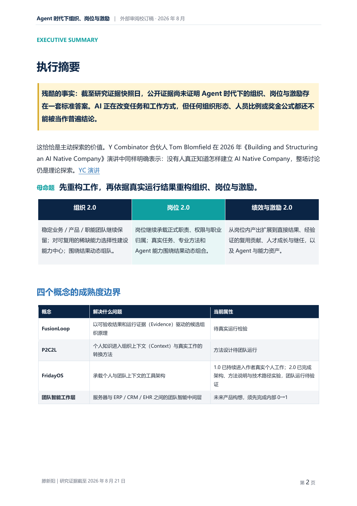

</details>

```text
Agent 时代下组织、岗位与激励 ｜ 外部审阅校订稿 · 2026 年8 月


EXECUTIVE SUMMARY

执行摘要


 残酷的事实：截至研究证据快照日，公开证据尚未证明Agent 时代下的组织、岗位与激励存
 在一套标准答案。AI 正在改变任务和工作方式，但任何组织形态、人员比例或奖金公式都还不
 能被当作普遍结论。


这恰恰是主动探索的价值。Y Combinator 合伙人Tom Blomfield 在2026 年《Building and Structuring
an AI Native Company》演讲中同样明确表示：没有人真正知道怎样建立AI Native Company，整场讨论
仍是理论探索。YC 演讲

母命题 先重构工作，再依据真实运行结果重构组织、岗位与激励。

        组织2.0                岗位2.0            绩效与激励2.0


 稳定业务／产品／职能团队继续保  岗位继续承载正式职责、权限与职业 从岗位内产出扩展到直接结果、经验
 留；对可复用的稀缺能力选择性建设 归属；真实任务、专业方法和    证的复用贡献、人才成长与继任，以
 能力中心；围绕结果动态组队。      Agent 能力围绕结果动态组合。     及Agent 与能力资产。


四个概念的成熟度边界


 概念         解决什么问题                   当前属性

              以可验收结果和运行证据（Evidence）驱动的候选组
  FusionLoop                              待真实运行检验
            织原理

             个人知识进入组织上下文（Context）与真实工作的
  P2C2L                                 方法设计待团队运行
            转换方法

                                                                              1.0 已持续进入作者真实个人工作；2.0 已完成
  FridayOS      承载个人与团队上下文的工具架构          架构、方法说明与技术路径实验，团队运行待验
                                     证

 团队智能工作层     服务器与ERP／CRM／EHR 之间的团队智能中间层   未来产品构想，须先完成内部0→1


 滕新阳｜研究证据截至2026 年8 月21 日                                                          第 2 页
```

<a id="page-03"></a>

## 第 3 页

[打开本页原图](pages/page-03.png) · [原始 PDF，第 3 页](agent-era-organization-roles-incentives.zh-CN.pdf#page=3)

<details>
<summary>展开原页图文排版</summary>

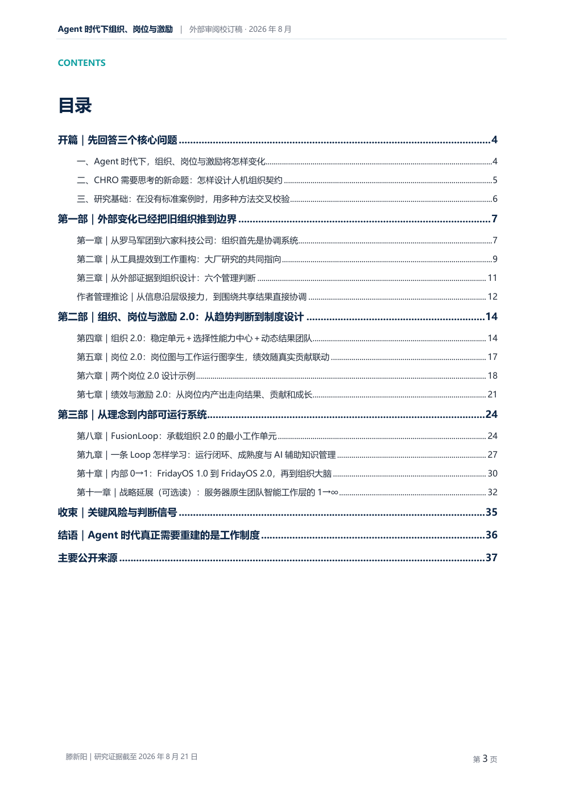

</details>

```text
Agent 时代下组织、岗位与激励 ｜ 外部审阅校订稿 · 2026 年8 月


CONTENTS

目录

开篇｜先回答三个核心问题 .............................................................................................................. 4

   一、Agent 时代下，组织、岗位与激励将怎样变化 ............................................................................................................... 4

   二、CHRO 需要思考的新命题：怎样设计人机组织契约 ...................................................................................................... 5

  三、研究基础：在没有标准案例时，用多种方法交叉校验 ................................................................................................... 6

第一部｜外部变化已经把旧组织推到边界 ......................................................................................... 7

      第一章｜从罗马军团到六家科技公司：组织首先是协调系统............................................................................................... 7

  第二章｜从工具提效到工作重构：大厂研究的共同指向 ....................................................................................................... 9

  第三章｜从外部证据到组织设计：六个管理判断 ................................................................................................................ 11

  作者管理推论｜从信息沿层级接力，到围绕共享结果直接协调 ....................................................................................... 12

第二部｜组织、岗位与激励2.0：从趋势判断到制度设计 ............................................................... 14

  第四章｜组织2.0：稳定单元＋选择性能力中心＋动态结果团队 ..................................................................................... 14

  第五章｜岗位2.0：岗位图与工作运行图孪生，绩效随真实贡献联动 ............................................................................ 17

   第六章｜两个岗位2.0 设计示例 .............................................................................................................................................. 18

  第七章｜绩效与激励2.0：从岗位内产出走向结果、贡献和成长 ..................................................................................... 21

第三部｜从理念到内部可运行系统 .................................................................................................. 24

   第八章｜FusionLoop：承载组织2.0 的最小工作单元 ...................................................................................................... 24

   第九章｜一条Loop 怎样学习：运行闭环、成熟度与AI 辅助知识管理 ......................................................................... 27

   第十章｜内部0→1：FridayOS 1.0 到FridayOS 2.0，再到组织大脑 ........................................................................... 30

  第十一章｜战略延展（可选读）：服务器原生团队智能工作层的1→∞ ........................................................................ 32

收束｜关键风险与判断信号 ............................................................................................................ 35

结语｜Agent 时代真正需要重建的是工作制度 ............................................................................... 36

主要公开来源 ................................................................................................................................. 37


 滕新阳｜研究证据截至2026 年8 月21 日                                                          第 3 页
```

<a id="page-04"></a>

## 第 4 页

[打开本页原图](pages/page-04.png) · [原始 PDF，第 4 页](agent-era-organization-roles-incentives.zh-CN.pdf#page=4)

<details>
<summary>展开原页图文排版</summary>

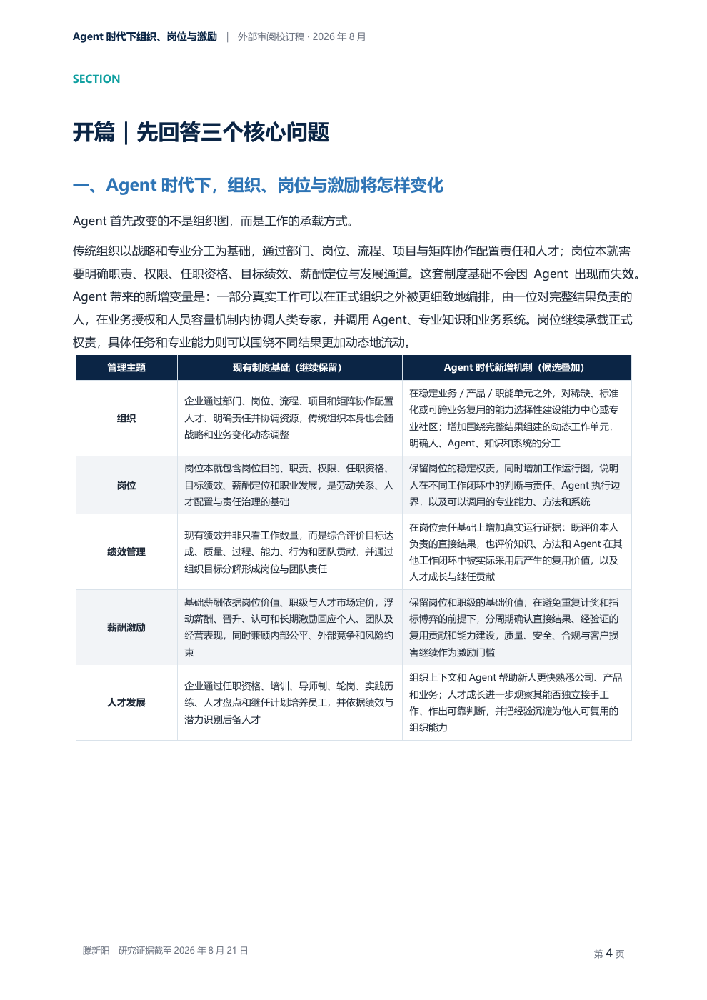

</details>

```text
Agent 时代下组织、岗位与激励 ｜ 外部审阅校订稿 · 2026 年8 月


SECTION

开篇｜先回答三个核心问题

一、Agent 时代下，组织、岗位与激励将怎样变化

Agent 首先改变的不是组织图，而是工作的承载方式。

传统组织以战略和专业分工为基础，通过部门、岗位、流程、项目与矩阵协作配置责任和人才；岗位本就需
要明确职责、权限、任职资格、目标绩效、薪酬定位与发展通道。这套制度基础不会因Agent 出现而失效。
Agent 带来的新增变量是：一部分真实工作可以在正式组织之外被更细致地编排，由一位对完整结果负责的
人，在业务授权和人员容量机制内协调人类专家，并调用Agent、专业知识和业务系统。岗位继续承载正式
权责，具体任务和专业能力则可以围绕不同结果更加动态地流动。

    管理主题         现有制度基础（继续保留）                 Agent 时代新增机制（候选叠加）

                                   在稳定业务／产品／职能单元之外，对稀缺、标准
            企业通过部门、岗位、流程、项目和矩阵协作配置
                                   化或可跨业务复用的能力选择性建设能力中心或专
     组织     人才、明确责任并协调资源，传统组织本身也会随
                                   业社区；增加围绕完整结果组建的动态工作单元，
            战略和业务变化动态调整
                                        明确人、Agent、知识和系统的分工

            岗位本就包含岗位目的、职责、权限、任职资格、  保留岗位的稳定权责，同时增加工作运行图，说明
     岗位     目标绩效、薪酬定位和职业发展，是劳动关系、人  人在不同工作闭环中的判断与责任、Agent 执行边
            才配置与责任治理的基础             界，以及可以调用的专业能力、方法和系统

                                   在岗位责任基础上增加真实运行证据：既评价本人
            现有绩效并非只看工作数量，而是综合评价目标达
                                       负责的直接结果，也评价知识、方法和Agent 在其
    绩效管理    成、质量、过程、能力、行为和团队贡献，并通过
                                   他工作闭环中被实际采用后产生的复用价值，以及
            组织目标分解形成岗位与团队责任
                                   人才成长与继任贡献

            基础薪酬依据岗位价值、职级与人才市场定价，浮  保留岗位和职级的基础价值；在避免重复计奖和指
            动薪酬、晋升、认可和长期激励回应个人、团队及  标博弈的前提下，分周期确认直接结果、经验证的
    薪酬激励
            经营表现，同时兼顾内部公平、外部竞争和风险约  复用贡献和能力建设，质量、安全、合规与客户损
            束                       害继续作为激励门槛

                                           组织上下文和Agent 帮助新人更快熟悉公司、产品
            企业通过任职资格、培训、导师制、轮岗、实践历
                                   和业务；人才成长进一步观察其能否独立接手工
    人才发展    练、人才盘点和继任计划培养员工，并依据绩效与
                                   作、作出可靠判断，并把经验沉淀为他人可复用的
            潜力识别后备人才
                                   组织能力


 滕新阳｜研究证据截至2026 年8 月21 日                                                          第 4 页
```

<a id="page-05"></a>

## 第 5 页

[打开本页原图](pages/page-05.png) · [原始 PDF，第 5 页](agent-era-organization-roles-incentives.zh-CN.pdf#page=5)

<details>
<summary>展开原页图文排版</summary>

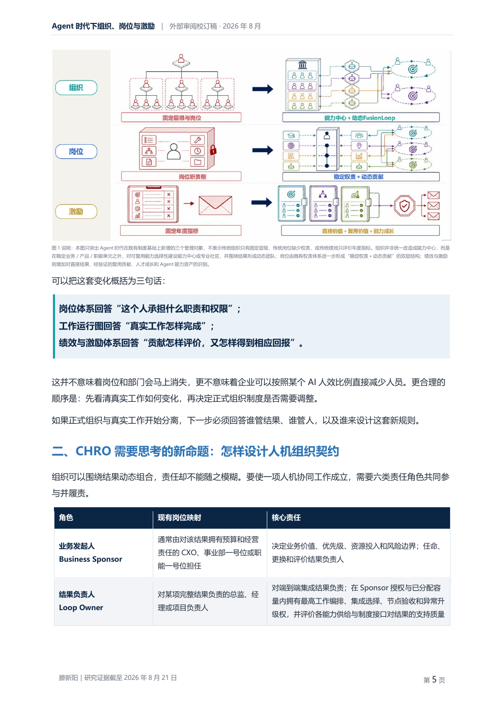

</details>

```text
Agent 时代下组织、岗位与激励 ｜ 外部审阅校订稿 · 2026 年8 月


图1 说明：本图只突出Agent 时代在既有制度基础上新增的三个管理对象，不表示传统组织只有固定层级、传统岗位缺少权责，或传统绩效只评价年度指标。组织并非统一改造成能力中心，而是
在稳定业务／产品／职能单元之外，对可复用能力选择性建设能力中心或专业社区，并围绕结果形成动态团队；岗位由既有权责体系进一步形成“稳定权责＋动态贡献”的双层结构；绩效与激励
则增加对直接结果、经验证的复用贡献、人才成长和Agent 能力资产的识别。

可以把这套变化概括为三句话：

 岗位体系回答“这个人承担什么职责和权限”；
 工作运行图回答“真实工作怎样完成”；
 绩效与激励体系回答“贡献怎样评价，又怎样得到相应回报”。


这并不意味着岗位和部门会马上消失，更不意味着企业可以按照某个AI 人效比例直接减少人员。更合理的
顺序是：先看清真实工作如何变化，再决定正式组织制度是否需要调整。

如果正式组织与真实工作开始分离，下一步必须回答谁管结果、谁管人，以及谁来设计这套新规则。

二、CHRO 需要思考的新命题：怎样设计人机组织契约

组织可以围绕结果动态组合，责任却不能随之模糊。要使一项人机协同工作成立，需要六类责任角色共同参
与并履责。


 角色            现有岗位映射          核心责任

               通常由对该结果拥有预算和经营
 业务发起人                         决定业务价值、优先级、资源投入和风险边界；任命、
               责任的CXO、事业部一号位或职
  Business Sponsor                     更换和评价结果负责人
               能一号位担任

                                    对端到端集成结果负责；在Sponsor 授权与已分配容
 结果负责人         对某项完整结果负责的总监、经
                               量内拥有最高工作编排、集成选择、节点验收和异常升
  Loop Owner        理或项目负责人
                               级权，并评价各能力供给与制度接口对结果的支持质量


 滕新阳｜研究证据截至2026 年8 月21 日                                                          第 5 页
```

<a id="page-06"></a>

## 第 6 页

[打开本页原图](pages/page-06.png) · [原始 PDF，第 6 页](agent-era-organization-roles-incentives.zh-CN.pdf#page=6)

<details>
<summary>展开原页图文排版</summary>

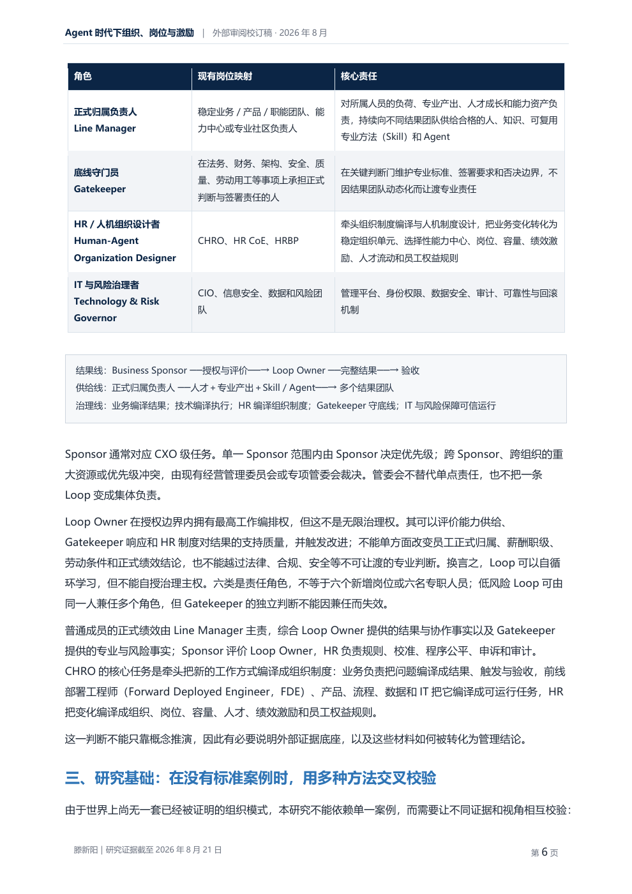

</details>

```text
Agent 时代下组织、岗位与激励 ｜ 外部审阅校订稿 · 2026 年8 月


 角色            现有岗位映射          核心责任

                               对所属人员的负荷、专业产出、人才成长和能力资产负
 正式归属负责人       稳定业务／产品／职能团队、能
                               责，持续向不同结果团队供给合格的人、知识、可复用
  Line Manager       力中心或专业社区负责人
                                           专业方法（Skill）和Agent

               在法务、财务、架构、安全、质
 底线守门员                         在关键判断门维护专业标准、签署要求和否决边界，不
               量、劳动用工等事项上承担正式
  Gatekeeper                        因结果团队动态化而让渡专业责任
               判断与签署责任的人

 HR／人机组织设计者                    牵头组织制度编译与人机制度设计，把业务变化转化为
  Human-Agent         CHRO、HR CoE、HRBP     稳定组织单元、选择性能力中心、岗位、容量、绩效激
  Organization Designer                  励、人才流动和员工权益规则

  IT 与风险治理者
                CIO、信息安全、数据和风险团  管理平台、身份权限、数据安全、审计、可靠性与回滚
  Technology & Risk
               队               机制
  Governor


  结果线：Business Sponsor ──授权与评价──→ Loop Owner ──完整结果──→ 验收
 供给线：正式归属负责人 ──人才＋专业产出＋Skill／Agent──→ 多个结果团队
 治理线：业务编译结果；技术编译执行；HR 编译组织制度；Gatekeeper 守底线；IT 与风险保障可信运行


Sponsor 通常对应CXO 级任务。单一Sponsor 范围内由Sponsor 决定优先级；跨Sponsor、跨组织的重
大资源或优先级冲突，由现有经营管理委员会或专项管委会裁决。管委会不替代单点责任，也不把一条
Loop 变成集体负责。

Loop Owner 在授权边界内拥有最高工作编排权，但这不是无限治理权。其可以评价能力供给、
Gatekeeper 响应和HR 制度对结果的支持质量，并触发改进；不能单方面改变员工正式归属、薪酬职级、
劳动条件和正式绩效结论，也不能越过法律、合规、安全等不可让渡的专业判断。换言之，Loop 可以自循
环学习，但不能自授治理主权。六类是责任角色，不等于六个新增岗位或六名专职人员；低风险Loop 可由
同一人兼任多个角色，但Gatekeeper 的独立判断不能因兼任而失效。

普通成员的正式绩效由Line Manager 主责，综合Loop Owner 提供的结果与协作事实以及Gatekeeper
提供的专业与风险事实；Sponsor 评价Loop Owner，HR 负责规则、校准、程序公平、申诉和审计。
CHRO 的核心任务是牵头把新的工作方式编译成组织制度：业务负责把问题编译成结果、触发与验收，前线
部署工程师（Forward Deployed Engineer，FDE）、产品、流程、数据和IT 把它编译成可运行任务，HR
把变化编译成组织、岗位、容量、人才、绩效激励和员工权益规则。

这一判断不能只靠概念推演，因此有必要说明外部证据底座，以及这些材料如何被转化为管理结论。

三、研究基础：在没有标准案例时，用多种方法交叉校验

由于世界上尚无一套已经被证明的组织模式，本研究不能依赖单一案例，而需要让不同证据和视角相互校验：


 滕新阳｜研究证据截至2026 年8 月21 日                                                          第 6 页
```

<a id="page-07"></a>

## 第 7 页

[打开本页原图](pages/page-07.png) · [原始 PDF，第 7 页](agent-era-organization-roles-incentives.zh-CN.pdf#page=7)

<details>
<summary>展开原页图文排版</summary>

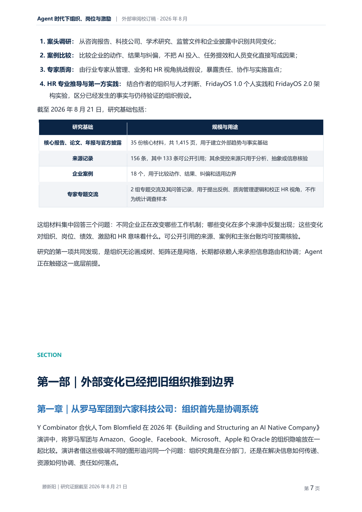

</details>

```text
Agent 时代下组织、岗位与激励 ｜ 外部审阅校订稿 · 2026 年8 月


 1. 案头调研： 从咨询报告、科技公司、学术研究、监管文件和企业披露中识别共同变化；

 2. 案例比较： 比较企业的动作、结果与纠偏，不把AI 投入、任务提效和人员变化直接写成因果；

 3. 专家质询： 由行业专家从管理、业务和HR 视角挑战假设，暴露责任、协作与实施盲点；

 4. HR 专业推导与第一方实践： 结合作者的组织与人才判断、FridayOS 1.0 个人实践和FridayOS 2.0 架
  构实验，区分已经发生的事实与仍待验证的组织假设。

截至2026 年8 月21 日，研究基础包括：


       研究基础                       规模与用途

 核心报告、论文、年报与官方披露   35 份核心材料，共1,415 页，用于建立外部趋势与事实基础

       来源记录            156 条，其中133 条可公开引用；其余受控来源只用于分析、抽象或信息核验

       企业案例            18 个，用于比较动作、结果、纠偏和适用边界

                               2 组专题交流及其问答记录，用于提出反例、质询管理逻辑和校正HR 视角，不作
      专家专题交流
                  为统计调查样本


这组材料集中回答三个问题：不同企业正在改变哪些工作机制；哪些变化在多个来源中反复出现；这些变化
对组织、岗位、绩效、激励和HR 意味着什么。可公开引用的来源、案例和主张台账均可按需核验。

研究的第一项共同发现，是组织无论画成树、矩阵还是网络，长期都依赖人来承担信息路由和协调；Agent
正在触碰这一底层前提。


SECTION

第一部｜外部变化已经把旧组织推到边界

第一章｜从罗马军团到六家科技公司：组织首先是协调系统

Y Combinator 合伙人Tom Blomfield 在2026 年《Building and Structuring an AI Native Company》
演讲中，将罗马军团与Amazon、Google、Facebook、Microsoft、Apple 和Oracle 的组织隐喻放在一
起比较。演讲者借这些极端不同的图形追问同一个问题：组织究竟是在分部门，还是在解决信息如何传递、
资源如何协调、责任如何落点。


 滕新阳｜研究证据截至2026 年8 月21 日                                                          第 7 页
```

<a id="page-08"></a>

## 第 8 页

[打开本页原图](pages/page-08.png) · [原始 PDF，第 8 页](agent-era-organization-roles-incentives.zh-CN.pdf#page=8)

<details>
<summary>展开原页图文排版</summary>

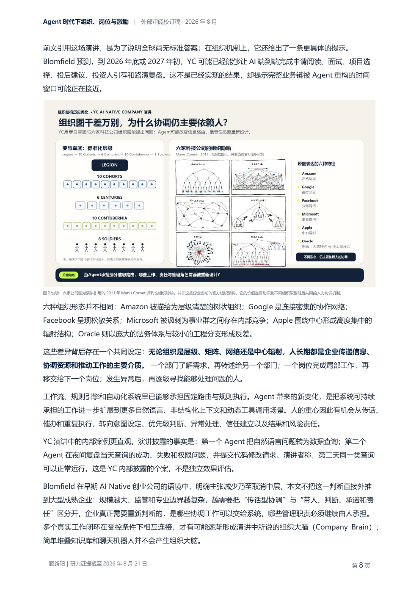

</details>

```text
Agent 时代下组织、岗位与激励 ｜ 外部审阅校订稿 · 2026 年8 月


前文引用这场演讲，是为了说明全球尚无标准答案；在组织机制上，它还给出了一条更具体的提示。
Blomfield 预测，到2026 年底或2027 年初，YC 可能已经能够让AI 端到端完成申请阅读、面试、项目选
择、投后建议、投资人引荐和路演复盘。这不是已经实现的结果，却提示完整业务链被Agent 重构的时间
窗口可能正在接近。


图2 说明：六家公司图为演讲引用的2011 年Manu Cornet 讽刺性组织隐喻，并非这些企业当前的官方组织架构。它的价值是帮助识别不同组织原型背后共同的人力协调机制。

六种组织形态并不相同：Amazon 被描绘为层级清楚的树状组织；Google 是连接密集的协作网络；
Facebook 呈现松散关系；Microsoft 被讽刺为事业群之间存在内部竞争；Apple 围绕中心形成高度集中的
辐射结构；Oracle 则以庞大的法务体系与较小的工程分支形成反差。

这些差异背后存在一个共同设定：无论组织是层级、矩阵、网络还是中心辐射，人长期都是企业传递信息、
协调资源和推动工作的主要介质。 一个部门了解需求，再转述给另一个部门；一个岗位完成局部工作，再
移交给下一个岗位；发生异常后，再逐级寻找能够处理问题的人。

工作流、规则引擎和自动化系统早已能够承担固定路由与规则执行。Agent 带来的新变化，是把系统可持续
承担的工作进一步扩展到更多自然语言、非结构化上下文和动态工具调用场景。人的重心因此有机会从传话、
催办和重复执行，转向意图设定、优先级判断、异常处理、信任建立以及结果和风险责任。

YC 演讲中的内部案例更直观。演讲披露的事实是：第一个Agent 把自然语言问题转为数据查询；第二个
Agent 在夜间复盘当天查询的成功、失败和权限问题，并提交代码修改请求。演讲者称，第二天同一类查询
可以正常运行。这是YC 内部披露的个案，不是独立效果评估。

Blomfield 在早期AI Native 创业公司的语境中，明确主张减少乃至取消中层。本文不把这一判断直接外推
到大型成熟企业：规模越大、监管和专业边界越复杂，越需要把“传话型协调”与“带人、判断、承诺和责
任”区分开。企业真正需要重新判断的，是哪些协调工作可以交给系统，哪些管理职责必须继续由人承担。
多个真实工作闭环在受控条件下相互连接，才有可能逐渐形成演讲中所说的组织大脑（Company Brain）；
简单堆叠知识库和聊天机器人并不会产生组织大脑。


 滕新阳｜研究证据截至2026 年8 月21 日                                                          第 8 页
```

<a id="page-09"></a>

## 第 9 页

[打开本页原图](pages/page-09.png) · [原始 PDF，第 9 页](agent-era-organization-roles-incentives.zh-CN.pdf#page=9)

<details>
<summary>展开原页图文排版</summary>

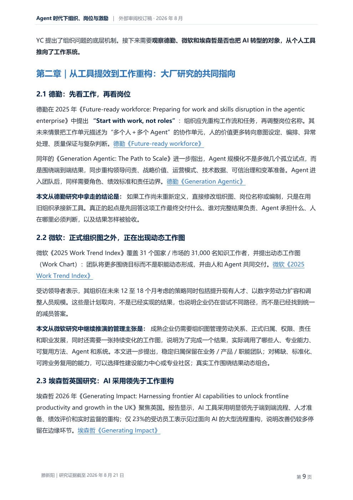

</details>

```text
Agent 时代下组织、岗位与激励 ｜ 外部审阅校订稿 · 2026 年8 月


YC 提出了组织问题的底层机制。接下来需要观察德勤、微软和埃森哲是否也把AI 转型的对象，从个人工具
推向了工作系统。

第二章｜从工具提效到工作重构：大厂研究的共同指向

2.1 德勤：先看工作，再看岗位

德勤在2025 年《Future-ready workforce: Preparing for work and skills disruption in the agentic
enterprise》中提出 “Start with work, not roles”：组织应先重构工作流和任务，再调整岗位名称。其
未来情景把工作单元描述为“多个人＋多个Agent”的协作单元，人的价值更多转向意图设定、编排、异常
处理、质量保证与复杂判断。德勤《Future-ready workforce》

同年的《Generation Agentic: The Path to Scale》进一步指出，Agent 规模化不是多做几个孤立试点，而
是围绕端到端结果，同步重构领导问责、战略价值、运营模式、技术数据、可信治理和变革准备。Agent 进
入团队后，同样需要角色、绩效标准和责任边界。德勤《Generation Agentic》

本文从德勤研究中拿走的结论是： 如果工作尚未重新定义，直接修改组织图、岗位名称或编制，只是在用
旧组织承接新工具。真正的起点是先回答这项工作最终交付什么、谁对完整结果负责、Agent 承担什么、人
在哪里必须判断，以及结果怎样被验收。

2.2 微软：正式组织图之外，正在出现动态工作图

微软《2025 Work Trend Index》覆盖31 个国家／市场的31,000 名知识工作者，并提出动态工作图
（Work Chart）：团队将更多围绕目标而不是职能动态形成，并由人和Agent 共同交付。微软《2025
Work Trend Index》

受访领导者表示，其组织在未来12 至18 个月考虑的策略同时包括提升现有人才、以数字劳动力扩容和调
整人员规模。这些是计划取向，不是已经实现的结果，也说明企业仍在尝试不同路径，而不是已经找到统一
的减员答案。

本文从微软研究中继续推演的管理主张是： 成熟企业仍需要组织图管理劳动关系、正式归属、权限、责任
和职业发展，同时还需要一张持续变化的工作图，说明为了完成一个结果，实际调用了哪些人、专业能力、
可复用方法、Agent 和系统。本文进一步提出，稳定归属保留在业务／产品／职能团队；对稀缺、标准化、
可跨业务复用的能力，可以选择性建设能力中心或专业社区；真实工作围绕结果动态组合。

2.3 埃森哲英国研究：AI 采用领先于工作重构

埃森哲2026 年《Generating Impact: Harnessing frontier AI capabilities to unlock frontline
productivity and growth in the UK》聚焦英国。报告显示，AI 工具采用明显领先于端到端流程、人才准
备、绩效评价和实时监督的重构；仅23%的受访员工表示见过面向AI 的大型流程重构，说明改善仍较多停
留在边缘环节。埃森哲《Generating Impact》


 滕新阳｜研究证据截至2026 年8 月21 日                                                          第 9 页
```

<a id="page-10"></a>

## 第 10 页

[打开本页原图](pages/page-10.png) · [原始 PDF，第 10 页](agent-era-organization-roles-incentives.zh-CN.pdf#page=10)

<details>
<summary>展开原页图文排版</summary>

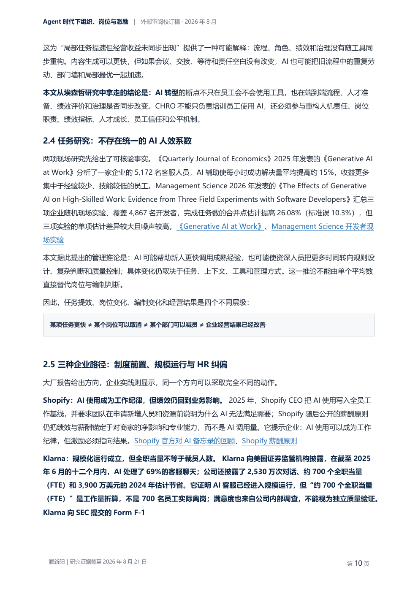

</details>

```text
Agent 时代下组织、岗位与激励 ｜ 外部审阅校订稿 · 2026 年8 月


这为“局部任务提速但经营收益未同步出现”提供了一种可能解释：流程、角色、绩效和治理没有随工具同
步重构。内容生成可以更快，但如果会议、交接、等待和责任空白没有改变，AI 也可能把旧流程中的重复劳
动、部门墙和局部最优一起加速。

本文从埃森哲研究中拿走的结论是：AI 转型的断点不只在员工会不会使用工具，也在端到端流程、人才准
备、绩效评价和治理是否同步改变。CHRO 不能只负责培训员工使用AI，还必须参与重构人机责任、岗位
职责、绩效指标、人才成长、员工信任和公平机制。

2.4 任务研究：不存在统一的AI 人效系数

两项现场研究先给出了可核验事实。《Quarterly Journal of Economics》2025 年发表的《Generative AI
at Work》分析了一家企业的5,172 名客服人员，AI 辅助使每小时成功解决量平均提高约15%，收益更多
集中于经验较少、技能较低的员工。Management Science 2026 年发表的《The Effects of Generative
AI on High-Skilled Work: Evidence from Three Field Experiments with Software Developers》汇总三
项企业随机现场实验、覆盖4,867 名开发者，完成任务数的合并点估计提高26.08%（标准误10.3%），但
三项实验的单项估计差异较大且噪声较高。《Generative AI at Work》、Management Science 开发者现
场实验

本文据此提出的管理推论是：AI 可能帮助新人更快调用成熟经验，也可能使资深人员把更多时间转向规则设
计、复杂判断和质量控制；具体变化仍取决于任务、上下文、工具和管理方式。这一推论不能由单个平均数
直接替代岗位与编制判断。

因此，任务提效、岗位变化、编制变化和经营结果是四个不同层级：


 某项任务更快 ≠ 某个岗位可以取消 ≠ 某个部门可以减员 ≠ 企业经营结果已经改善


2.5 三种企业路径：制度前置、规模运行与HR 纠偏

大厂报告给出方向，企业实践则显示，同一个方向可以采取完全不同的动作。

Shopify：AI 使用成为工作纪律，但绩效仍回到业务影响。 2025 年，Shopify CEO 把AI 使用写入全员工
作基线，并要求团队在申请新增人员和资源前说明为什么AI 无法满足需要；Shopify 随后公开的薪酬原则
仍把绩效与薪酬锚定于对商家的净影响和专业能力，而不是AI 调用量。它提示企业：AI 使用可以成为工作
纪律，但激励必须指向结果。Shopify 官方对AI 备忘录的回顾、Shopify 薪酬原则

Klarna：规模化运行成立，但全职当量不等于裁员人数。 Klarna 向美国证券监管机构披露，在截至2025
年6 月的十二个月内，AI 处理了69%的客服聊天；公司还披露了2,530 万次对话、约700 个全职当量
（FTE）和3,900 万美元的2024 年估计节省。它证明AI 客服已经进入规模运行，但“约700 个全职当量
（FTE）”是工作量折算，不是700 名员工实际离岗；满意度也来自公司内部调查，不能视为独立质量验证。
Klarna 向SEC 提交的Form F-1


 滕新阳｜研究证据截至2026 年8 月21 日                                                         第 10 页
```

<a id="page-11"></a>

## 第 11 页

[打开本页原图](pages/page-11.png) · [原始 PDF，第 11 页](agent-era-organization-roles-incentives.zh-CN.pdf#page=11)

<details>
<summary>展开原页图文排版</summary>

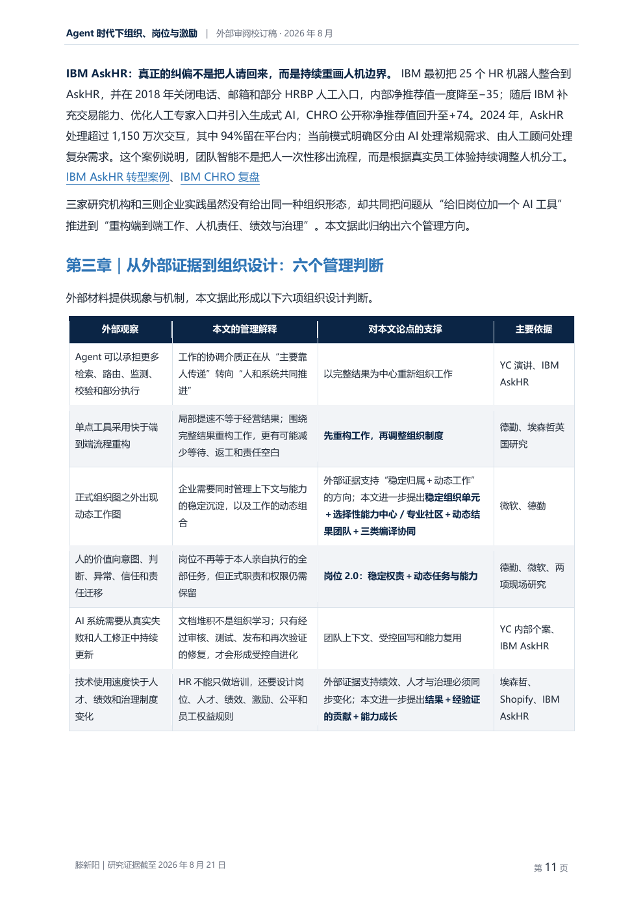

</details>

```text
Agent 时代下组织、岗位与激励 ｜ 外部审阅校订稿 · 2026 年8 月


IBM AskHR：真正的纠偏不是把人请回来，而是持续重画人机边界。 IBM 最初把25 个HR 机器人整合到
AskHR，并在2018 年关闭电话、邮箱和部分HRBP 人工入口，内部净推荐值一度降至−35；随后IBM 补
充交易能力、优化人工专家入口并引入生成式AI，CHRO 公开称净推荐值回升至+74。2024 年，AskHR
处理超过1,150 万次交互，其中94%留在平台内；当前模式明确区分由AI 处理常规需求、由人工顾问处理
复杂需求。这个案例说明，团队智能不是把人一次性移出流程，而是根据真实员工体验持续调整人机分工。
IBM AskHR 转型案例、IBM CHRO 复盘

三家研究机构和三则企业实践虽然没有给出同一种组织形态，却共同把问题从“给旧岗位加一个AI 工具”
推进到“重构端到端工作、人机责任、绩效与治理”。本文据此归纳出六个管理方向。

第三章｜从外部证据到组织设计：六个管理判断

外部材料提供现象与机制，本文据此形成以下六项组织设计判断。


    外部观察        本文的管理解释          对本文论点的支撑        主要依据

  Agent 可以承担更多  工作的协调介质正在从“主要靠
                                                                          YC 演讲、IBM
 检索、路由、监测、  人传递”转向“人和系统共同推  以完整结果为中心重新组织工作
                                                                           AskHR
 校验和部分执行    进”

            局部提速不等于经营结果；围绕
 单点工具采用快于端                                     德勤、埃森哲英
            完整结果重构工作，更有可能减  先重构工作，再调整组织制度
 到端流程重构                                        国研究
            少等待、返工和责任空白

                            外部证据支持“稳定归属＋动态工作”
            企业需要同时管理上下文与能力
 正式组织图之外出现                  的方向；本文进一步提出稳定组织单元
            的稳定沉淀，以及工作的动态组                     微软、德勤
 动态工作图                      ＋选择性能力中心／专业社区＋动态结
            合
                            果团队＋三类编译协同

 人的价值向意图、判  岗位不再等于本人亲自执行的全
                                               德勤、微软、两
 断、异常、信任和责  部任务，但正式职责和权限仍需  岗位2.0：稳定权责＋动态任务与能力
                                               项现场研究
 任迁移        保留

  AI 系统需要从真实失  文档堆积不是组织学习；只有经
                                                                          YC 内部个案、
 败和人工修正中持续  过审核、测试、发布和再次验证  团队上下文、受控回写和能力复用
                                                                          IBM AskHR
 更新         的修复，才会形成受控自进化

 技术使用速度快于人   HR 不能只做培训，还要设计岗  外部证据支持绩效、人才与治理必须同  埃森哲、
 才、绩效和治理制度  位、人才、绩效、激励、公平和  步变化；本文进一步提出结果＋经验证    Shopify、IBM
 变化         员工权益规则          的贡献＋能力成长                  AskHR


 滕新阳｜研究证据截至2026 年8 月21 日                                                         第 11 页
```

<a id="page-12"></a>

## 第 12 页

[打开本页原图](pages/page-12.png) · [原始 PDF，第 12 页](agent-era-organization-roles-incentives.zh-CN.pdf#page=12)

<details>
<summary>展开原页图文排版</summary>

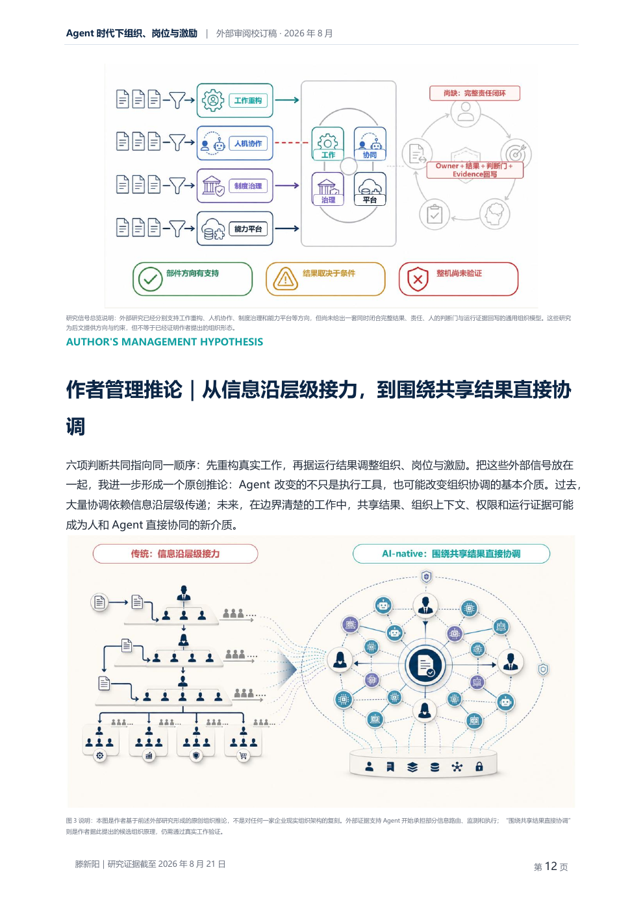

</details>

```text
Agent 时代下组织、岗位与激励 ｜ 外部审阅校订稿 · 2026 年8 月


研究信号总览说明：外部研究已经分别支持工作重构、人机协作、制度治理和能力平台等方向，但尚未给出一套同时闭合完整结果、责任、人的判断门与运行证据回写的通用组织模型。这些研究
为后文提供方向与约束，但不等于已经证明作者提出的组织形态。
AUTHOR'S MANAGEMENT HYPOTHESIS

作者管理推论｜从信息沿层级接力，到围绕共享结果直接协
调

六项判断共同指向同一顺序：先重构真实工作，再据运行结果调整组织、岗位与激励。把这些外部信号放在
一起，我进一步形成一个原创推论：Agent 改变的不只是执行工具，也可能改变组织协调的基本介质。过去，
大量协调依赖信息沿层级传递；未来，在边界清楚的工作中，共享结果、组织上下文、权限和运行证据可能
成为人和Agent 直接协同的新介质。


图3 说明：本图是作者基于前述外部研究形成的原创组织推论，不是对任何一家企业现实组织架构的复刻。外部证据支持Agent 开始承担部分信息路由、监测和执行；“围绕共享结果直接协调”
则是作者据此提出的候选组织原理，仍需通过真实工作验证。


 滕新阳｜研究证据截至2026 年8 月21 日                                                         第 12 页
```

<a id="page-13"></a>

## 第 13 页

[打开本页原图](pages/page-13.png) · [原始 PDF，第 13 页](agent-era-organization-roles-incentives.zh-CN.pdf#page=13)

<details>
<summary>展开原页图文排版</summary>

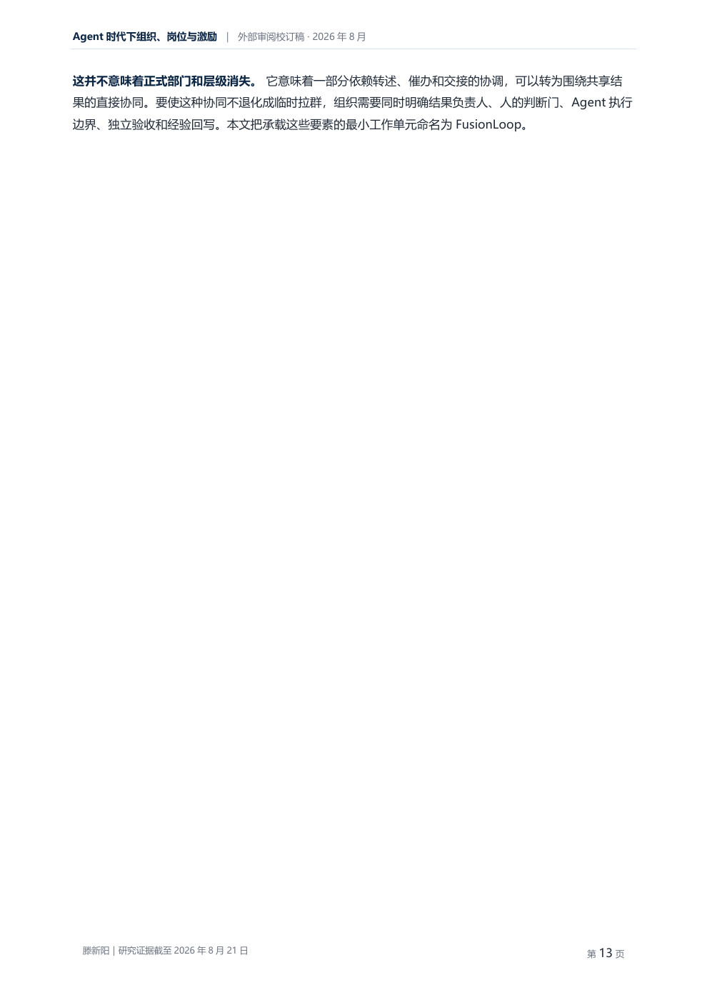

</details>

```text
Agent 时代下组织、岗位与激励 ｜ 外部审阅校订稿 · 2026 年8 月


这并不意味着正式部门和层级消失。 它意味着一部分依赖转述、催办和交接的协调，可以转为围绕共享结
果的直接协同。要使这种协同不退化成临时拉群，组织需要同时明确结果负责人、人的判断门、Agent 执行
边界、独立验收和经验回写。本文把承载这些要素的最小工作单元命名为FusionLoop。


 滕新阳｜研究证据截至2026 年8 月21 日                                                         第 13 页
```

<a id="page-14"></a>

## 第 14 页

[打开本页原图](pages/page-14.png) · [原始 PDF，第 14 页](agent-era-organization-roles-incentives.zh-CN.pdf#page=14)

<details>
<summary>展开原页图文排版</summary>

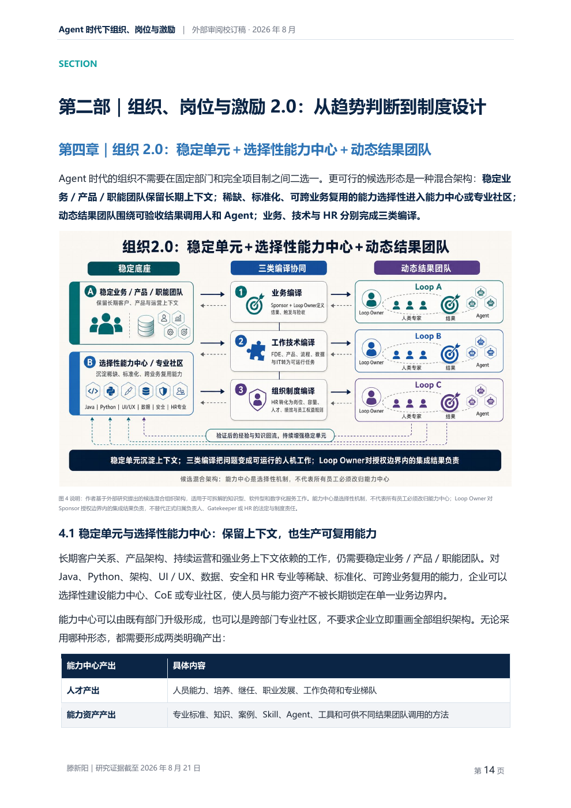

</details>

```text
Agent 时代下组织、岗位与激励 ｜ 外部审阅校订稿 · 2026 年8 月


SECTION

第二部｜组织、岗位与激励2.0：从趋势判断到制度设计

第四章｜组织2.0：稳定单元＋选择性能力中心＋动态结果团队

Agent 时代的组织不需要在固定部门和完全项目制之间二选一。更可行的候选形态是一种混合架构：稳定业
务／产品／职能团队保留长期上下文；稀缺、标准化、可跨业务复用的能力选择性进入能力中心或专业社区；
动态结果团队围绕可验收结果调用人和Agent；业务、技术与HR 分别完成三类编译。


图4 说明：作者基于外部研究提出的候选混合组织架构，适用于可拆解的知识型、软件型和数字化服务工作。能力中心是选择性机制，不代表所有员工必须改归能力中心；Loop Owner 对
Sponsor 授权边界内的集成结果负责，不替代正式归属负责人、Gatekeeper 或HR 的法定与制度责任。

4.1 稳定单元与选择性能力中心：保留上下文，也生产可复用能力

长期客户关系、产品架构、持续运营和强业务上下文依赖的工作，仍需要稳定业务／产品／职能团队。对
Java、Python、架构、UI／UX、数据、安全和HR 专业等稀缺、标准化、可跨业务复用的能力，企业可以
选择性建设能力中心、CoE 或专业社区，使人员与能力资产不被长期锁定在单一业务边界内。

能力中心可以由既有部门升级形成，也可以是跨部门专业社区，不要求企业立即重画全部组织架构。无论采
用哪种形态，都需要形成两类明确产出：


 能力中心产出       具体内容

 人才产出         人员能力、培养、继任、职业发展、工作负荷和专业梯队

 能力资产产出        专业标准、知识、案例、Skill、Agent、工具和可供不同结果团队调用的方法


 滕新阳｜研究证据截至2026 年8 月21 日                                                         第 14 页
```

<a id="page-15"></a>

## 第 15 页

[打开本页原图](pages/page-15.png) · [原始 PDF，第 15 页](agent-era-organization-roles-incentives.zh-CN.pdf#page=15)

<details>
<summary>展开原页图文排版</summary>

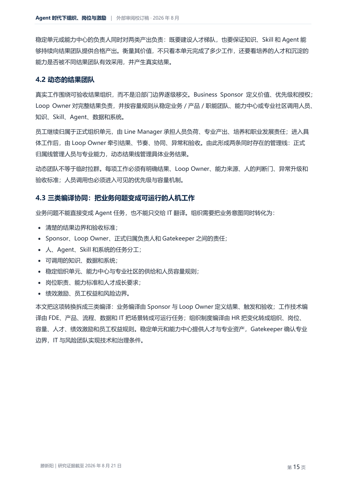

</details>

```text
Agent 时代下组织、岗位与激励 ｜ 外部审阅校订稿 · 2026 年8 月


稳定单元或能力中心的负责人同时对两类产出负责：既要建设人才梯队，也要保证知识、Skill 和Agent 能
够持续向结果团队提供合格产出。衡量其价值，不只看本单元完成了多少工作，还要看培养的人才和沉淀的
能力是否被不同结果团队有效采用，并产生真实结果。

4.2 动态的结果团队

真实工作围绕可验收结果组织，而不是沿部门边界逐级移交。Business Sponsor 定义价值、优先级和授权；
Loop Owner 对完整结果负责，并按容量规则从稳定业务／产品／职能团队、能力中心或专业社区调用人员、
知识、Skill、Agent、数据和系统。

员工继续归属于正式组织单元，由Line Manager 承担人员负荷、专业产出、培养和职业发展责任；进入具
体工作后，由Loop Owner 牵引结果、节奏、协同、异常和验收。由此形成两条同时存在的管理线：正式
归属线管理人员与专业能力，动态结果线管理具体业务结果。

动态团队不等于临时拉群。每项工作必须有明确结果、Loop Owner、能力来源、人的判断门、异常升级和
验收标准；人员调用也必须进入可见的优先级与容量机制。

4.3 三类编译协同：把业务问题变成可运行的人机工作

业务问题不能直接变成Agent 任务，也不能只交给IT 翻译。组织需要把业务意图同时转化为：

 • 清楚的结果边界和验收标准；
 • Sponsor、Loop Owner、正式归属负责人和Gatekeeper 之间的责任；
 • 人、Agent、Skill 和系统的任务分工；
 • 可调用的知识、数据和系统；
 • 稳定组织单元、能力中心与专业社区的供给和人员容量规则；
 • 岗位职责、能力标准和人才成长要求；
 • 绩效激励、员工权益和风险边界。

本文把这项转换拆成三类编译：业务编译由Sponsor 与Loop Owner 定义结果、触发和验收；工作技术编
译由FDE、产品、流程、数据和IT 把场景转成可运行任务；组织制度编译由HR 把变化转成组织、岗位、
容量、人才、绩效激励和员工权益规则。稳定单元和能力中心提供人才与专业资产，Gatekeeper 确认专业
边界，IT 与风险团队实现技术和治理条件。


 滕新阳｜研究证据截至2026 年8 月21 日                                                         第 15 页
```

<a id="page-16"></a>

## 第 16 页

[打开本页原图](pages/page-16.png) · [原始 PDF，第 16 页](agent-era-organization-roles-incentives.zh-CN.pdf#page=16)

<details>
<summary>展开原页图文排版</summary>

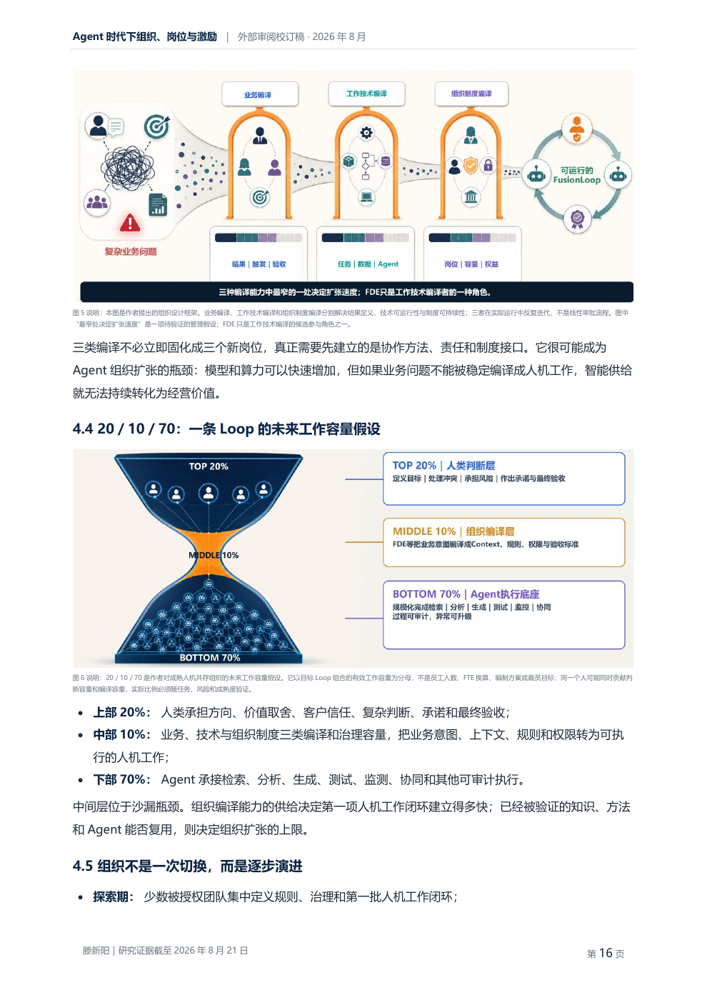

</details>

```text
Agent 时代下组织、岗位与激励 ｜ 外部审阅校订稿 · 2026 年8 月


图5 说明：本图是作者提出的组织设计框架。业务编译、工作技术编译和组织制度编译分别解决结果定义、技术可运行性与制度可持续性；三者在实际运行中反复迭代，不是线性审批流程。图中
“最窄处决定扩张速度”是一项待验证的管理假设；FDE 只是工作技术编译的候选参与角色之一。

三类编译不必立即固化成三个新岗位，真正需要先建立的是协作方法、责任和制度接口。它很可能成为
Agent 组织扩张的瓶颈：模型和算力可以快速增加，但如果业务问题不能被稳定编译成人机工作，智能供给
就无法持续转化为经营价值。

4.4 20／10／70：一条Loop 的未来工作容量假设


图6 说明：20／10／70 是作者对成熟人机共存组织的未来工作容量假设。它以目标Loop 组合的有效工作容量为分母，不是员工人数、FTE 换算、编制方案或裁员目标；同一个人可能同时贡献判
断容量和编译容量，实际比例必须随任务、风险和成熟度验证。

 • 上部20%： 人类承担方向、价值取舍、客户信任、复杂判断、承诺和最终验收；
 • 中部10%： 业务、技术与组织制度三类编译和治理容量，把业务意图、上下文、规则和权限转为可执
  行的人机工作；
 • 下部70%： Agent 承接检索、分析、生成、测试、监测、协同和其他可审计执行。

中间层位于沙漏瓶颈。组织编译能力的供给决定第一项人机工作闭环建立得多快；已经被验证的知识、方法
和Agent 能否复用，则决定组织扩张的上限。

4.5 组织不是一次切换，而是逐步演进

 • 探索期： 少数被授权团队集中定义规则、治理和第一批人机工作闭环；


 滕新阳｜研究证据截至2026 年8 月21 日                                                         第 16 页
```

<a id="page-17"></a>

## 第 17 页

[打开本页原图](pages/page-17.png) · [原始 PDF，第 17 页](agent-era-organization-roles-incentives.zh-CN.pdf#page=17)

<details>
<summary>展开原页图文排版</summary>

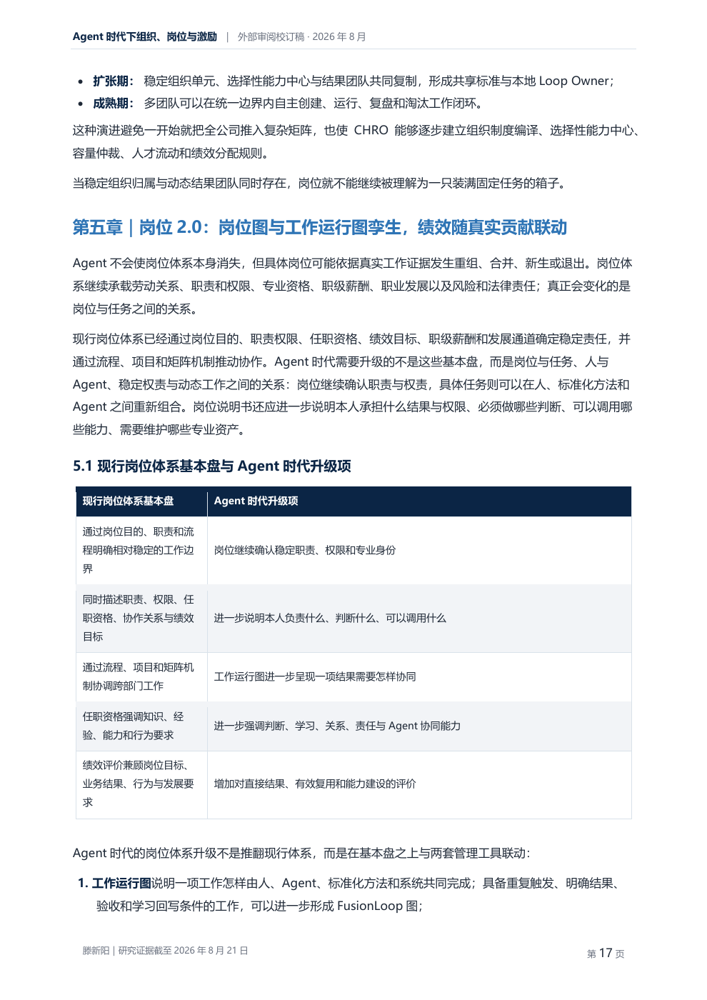

</details>

```text
Agent 时代下组织、岗位与激励 ｜ 外部审阅校订稿 · 2026 年8 月


 • 扩张期： 稳定组织单元、选择性能力中心与结果团队共同复制，形成共享标准与本地Loop Owner；
 • 成熟期： 多团队可以在统一边界内自主创建、运行、复盘和淘汰工作闭环。

这种演进避免一开始就把全公司推入复杂矩阵，也使CHRO 能够逐步建立组织制度编译、选择性能力中心、
容量仲裁、人才流动和绩效分配规则。

当稳定组织归属与动态结果团队同时存在，岗位就不能继续被理解为一只装满固定任务的箱子。

第五章｜岗位2.0：岗位图与工作运行图孪生，绩效随真实贡献联动

Agent 不会使岗位体系本身消失，但具体岗位可能依据真实工作证据发生重组、合并、新生或退出。岗位体
系继续承载劳动关系、职责和权限、专业资格、职级薪酬、职业发展以及风险和法律责任；真正会变化的是
岗位与任务之间的关系。

现行岗位体系已经通过岗位目的、职责权限、任职资格、绩效目标、职级薪酬和发展通道确定稳定责任，并
通过流程、项目和矩阵机制推动协作。Agent 时代需要升级的不是这些基本盘，而是岗位与任务、人与
Agent、稳定权责与动态工作之间的关系：岗位继续确认职责与权责，具体任务则可以在人、标准化方法和
Agent 之间重新组合。岗位说明书还应进一步说明本人承担什么结果与权限、必须做哪些判断、可以调用哪
些能力、需要维护哪些专业资产。

5.1 现行岗位体系基本盘与Agent 时代升级项

 现行岗位体系基本盘       Agent 时代升级项

 通过岗位目的、职责和流
 程明确相对稳定的工作边  岗位继续确认稳定职责、权限和专业身份
 界

 同时描述职责、权限、任
 职资格、协作关系与绩效  进一步说明本人负责什么、判断什么、可以调用什么
 目标

 通过流程、项目和矩阵机
              工作运行图进一步呈现一项结果需要怎样协同
 制协调跨部门工作

 任职资格强调知识、经
               进一步强调判断、学习、关系、责任与Agent 协同能力
 验、能力和行为要求

 绩效评价兼顾岗位目标、
 业务结果、行为与发展要  增加对直接结果、有效复用和能力建设的评价
 求


Agent 时代的岗位体系升级不是推翻现行体系，而是在基本盘之上与两套管理工具联动：

 1. 工作运行图说明一项工作怎样由人、Agent、标准化方法和系统共同完成；具备重复触发、明确结果、
  验收和学习回写条件的工作，可以进一步形成FusionLoop 图；


 滕新阳｜研究证据截至2026 年8 月21 日                                                         第 17 页
```

<a id="page-18"></a>

## 第 18 页

[打开本页原图](pages/page-18.png) · [原始 PDF，第 18 页](agent-era-organization-roles-incentives.zh-CN.pdf#page=18)

<details>
<summary>展开原页图文排版</summary>

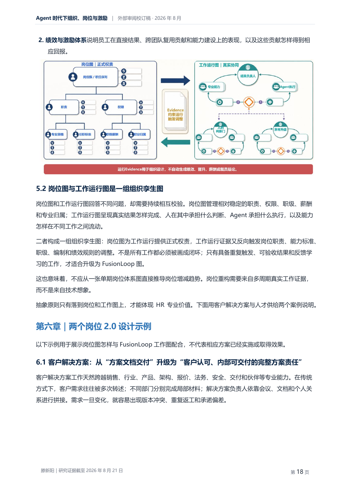

</details>

```text
Agent 时代下组织、岗位与激励 ｜ 外部审阅校订稿 · 2026 年8 月


 2. 绩效与激励体系说明员工在直接结果、跨团队复用贡献和能力建设上的表现，以及这些贡献怎样得到相
  应回报。


5.2 岗位图与工作运行图是一组组织孪生图

岗位图和工作运行图回答不同问题，却需要持续相互校验。岗位图管理相对稳定的职责、权限、职级、薪酬
和专业归属；工作运行图呈现真实结果怎样完成、人在其中承担什么判断、Agent 承担什么执行，以及能力
怎样在不同工作之间流动。

二者构成一组组织孪生图：岗位图为工作运行提供正式权责，工作运行证据又反向触发岗位职责、能力标准、
职级、编制和绩效规则的调整。不是所有工作都必须被画成闭环；只有具备重复触发、可验收结果和反馈学
习的工作，才适合升级为FusionLoop 图。

这也意味着，不应从一张单期岗位体系图直接推导岗位增减趋势。岗位重构需要来自多周期真实工作证据，
而不是来自技术想象。

抽象原则只有落到岗位和工作图上，才能体现HR 专业价值。下面用客户解决方案与人才供给两个案例说明。

第六章｜两个岗位2.0 设计示例

以下示例用于展示岗位图怎样与FusionLoop 工作图配合，不代表相应方案已经实施或取得效果。

6.1 客户解决方案：从“方案文档交付”升级为“客户认可、内部可交付的完整方案责任”

客户解决方案工作天然跨越销售、行业、产品、架构、报价、法务、安全、交付和伙伴等专业能力。在传统
方式下，客户需求往往被多次转述；不同部门分别完成局部材料；解决方案负责人依靠会议、文档和个人关
系进行拼接。需求一旦变化，就容易出现版本冲突、重复返工和承诺偏差。


 滕新阳｜研究证据截至2026 年8 月21 日                                                         第 18 页
```

<a id="page-19"></a>

## 第 19 页

[打开本页原图](pages/page-19.png) · [原始 PDF，第 19 页](agent-era-organization-roles-incentives.zh-CN.pdf#page=19)

<details>
<summary>展开原页图文排版</summary>

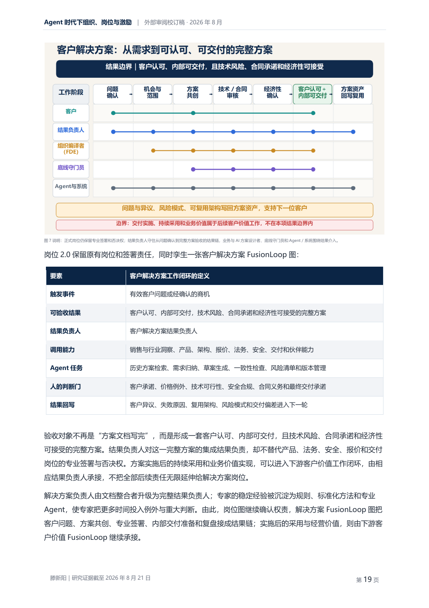

</details>

```text
Agent 时代下组织、岗位与激励 ｜ 外部审阅校订稿 · 2026 年8 月


图7 说明：正式岗位仍保留专业签署和否决权；结果负责人守住从问题确认到完整方案验收的结果链，业务与AI 方案设计者、底线守门员和Agent／系统围绕结果介入。

岗位2.0 保留原有岗位和签署责任，同时孪生一张客户解决方案FusionLoop 图：


 要素           客户解决方案工作闭环的定义

 触发事件         有效客户问题或经确认的商机

 可验收结果        客户认可、内部可交付，技术风险、合同承诺和经济性可接受的完整方案

 结果负责人        客户解决方案结果负责人

 调用能力         销售与行业洞察、产品、架构、报价、法务、安全、交付和伙伴能力

  Agent 任务        历史方案检索、需求归纳、草案生成、一致性检查、风险清单和版本管理

 人的判断门        客户承诺、价格例外、技术可行性、安全合规、合同义务和最终交付承诺

 结果回写         客户异议、失败原因、复用架构、风险模式和交付偏差进入下一轮


验收对象不再是“方案文档写完”，而是形成一套客户认可、内部可交付，且技术风险、合同承诺和经济性
可接受的完整方案。结果负责人对这一完整方案的集成结果负责，却不替代产品、法务、安全、报价和交付
岗位的专业签署与否决权。方案实施后的持续采用和业务价值实现，可以进入下游客户价值工作闭环，由相
应结果负责人承接，不把全部后续责任无限延伸给解决方案岗位。

解决方案负责人由文档整合者升级为完整结果负责人；专家的稳定经验被沉淀为规则、标准化方法和专业
Agent，使专家把更多时间投入例外与重大判断。由此，岗位图继续确认权责，解决方案FusionLoop 图把
客户问题、方案共创、专业签署、内部交付准备和复盘接成结果链；实施后的采用与经营价值，则由下游客
户价值FusionLoop 继续承接。


 滕新阳｜研究证据截至2026 年8 月21 日                                                         第 19 页
```

<a id="page-20"></a>

## 第 20 页

[打开本页原图](pages/page-20.png) · [原始 PDF，第 20 页](agent-era-organization-roles-incentives.zh-CN.pdf#page=20)

<details>
<summary>展开原页图文排版</summary>

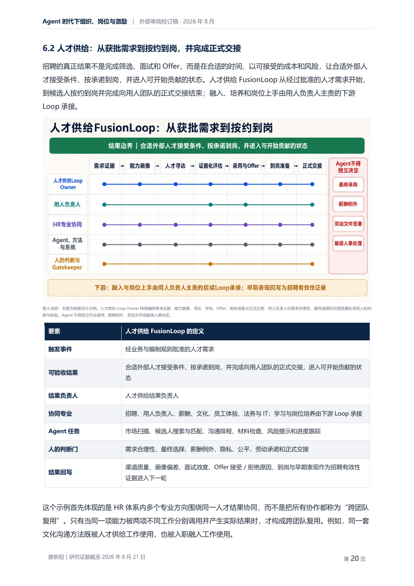

</details>

```text
Agent 时代下组织、岗位与激励 ｜ 外部审阅校订稿 · 2026 年8 月


6.2 人才供给：从获批需求到按约到岗，并完成正式交接

招聘的真正结果不是完成筛选、面试和Offer，而是在合适的时间、以可接受的成本和风险，让合适外部人
才接受条件、按承诺到岗，并进入可开始贡献的状态。人才供给FusionLoop 从经过批准的人才需求开始，
到候选人按约到岗并完成向用人团队的正式交接结束；融入、培养和岗位上手由用人负责人主责的下游
Loop 承接。


图8 说明：本图为制度设计示例。人才供给Loop Owner 持续编排需求证据、能力画像、寻访、评估、Offer、到岗准备与正式交接；用人负责人在需求合理性、最终选择和交接质量处承担人的判
断与验收。Agent 不得独立作出录用、薪酬例外、劳动文件或敏感人事决定。

 要素               人才供给FusionLoop 的定义

 触发事件         经业务与编制规则批准的人才需求

              合适外部人才接受条件、按承诺到岗，并完成向用人团队的正式交接，进入可开始贡献的状
 可验收结果
              态

 结果负责人        人才供给结果负责人

 协同专业          招聘、用人负责人、薪酬、文化、员工体验、法务与IT；学习与岗位培养由下游Loop 承接

  Agent 任务        市场扫描、候选人搜索与匹配、沟通排程、材料检查、风险提示和进度跟踪

 人的判断门        需求合理性、最终选择、薪酬例外、隐私、公平、劳动承诺和正式交接

                渠道质量、画像偏差、面试效度、Offer 接受／拒绝原因、到岗与早期表现作为招聘有效性
 结果回写
              证据进入下一轮


这个示例首先体现的是HR 体系内多个专业方向围绕同一人才结果协同，而不是把所有协作都称为“跨团队
复用”。只有当同一项能力被两项不同工作分别调用并产生实际结果时，才构成跨团队复用。例如，同一套
文化沟通方法既被人才供给工作使用，也被入职融入工作使用。


 滕新阳｜研究证据截至2026 年8 月21 日                                                         第 20 页
```

<a id="page-21"></a>

## 第 21 页

[打开本页原图](pages/page-21.png) · [原始 PDF，第 21 页](agent-era-organization-roles-incentives.zh-CN.pdf#page=21)

<details>
<summary>展开原页图文排版</summary>

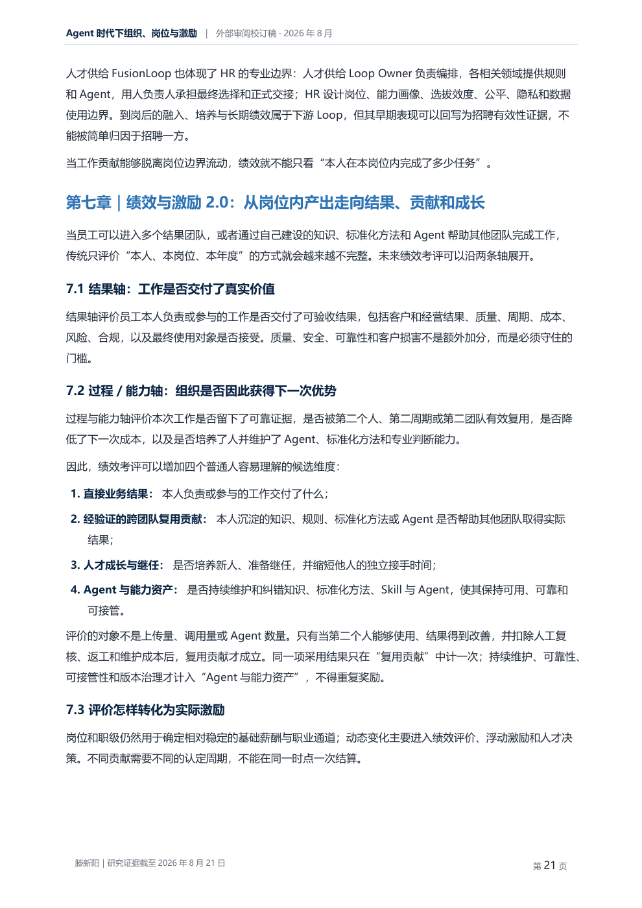

</details>

```text
Agent 时代下组织、岗位与激励 ｜ 外部审阅校订稿 · 2026 年8 月


人才供给FusionLoop 也体现了HR 的专业边界：人才供给Loop Owner 负责编排，各相关领域提供规则
和Agent，用人负责人承担最终选择和正式交接；HR 设计岗位、能力画像、选拔效度、公平、隐私和数据
使用边界。到岗后的融入、培养与长期绩效属于下游Loop，但其早期表现可以回写为招聘有效性证据，不
能被简单归因于招聘一方。

当工作贡献能够脱离岗位边界流动，绩效就不能只看“本人在本岗位内完成了多少任务”。

第七章｜绩效与激励2.0：从岗位内产出走向结果、贡献和成长

当员工可以进入多个结果团队，或者通过自己建设的知识、标准化方法和Agent 帮助其他团队完成工作，
传统只评价“本人、本岗位、本年度”的方式就会越来越不完整。未来绩效考评可以沿两条轴展开。

7.1 结果轴：工作是否交付了真实价值

结果轴评价员工本人负责或参与的工作是否交付了可验收结果，包括客户和经营结果、质量、周期、成本、
风险、合规，以及最终使用对象是否接受。质量、安全、可靠性和客户损害不是额外加分，而是必须守住的
门槛。

7.2 过程／能力轴：组织是否因此获得下一次优势

过程与能力轴评价本次工作是否留下了可靠证据，是否被第二个人、第二周期或第二团队有效复用，是否降
低了下一次成本，以及是否培养了人并维护了Agent、标准化方法和专业判断能力。

因此，绩效考评可以增加四个普通人容易理解的候选维度：

 1. 直接业务结果： 本人负责或参与的工作交付了什么；

 2. 经验证的跨团队复用贡献： 本人沉淀的知识、规则、标准化方法或Agent 是否帮助其他团队取得实际
  结果；

 3. 人才成长与继任： 是否培养新人、准备继任，并缩短他人的独立接手时间；

 4. Agent 与能力资产： 是否持续维护和纠错知识、标准化方法、Skill 与Agent，使其保持可用、可靠和
  可接管。

评价的对象不是上传量、调用量或Agent 数量。只有当第二个人能够使用、结果得到改善，并扣除人工复
核、返工和维护成本后，复用贡献才成立。同一项采用结果只在“复用贡献”中计一次；持续维护、可靠性、
可接管性和版本治理才计入“Agent 与能力资产”，不得重复奖励。

7.3 评价怎样转化为实际激励

岗位和职级仍然用于确定相对稳定的基础薪酬与职业通道；动态变化主要进入绩效评价、浮动激励和人才决
策。不同贡献需要不同的认定周期，不能在同一时点一次结算。


 滕新阳｜研究证据截至2026 年8 月21 日                                                         第 21 页
```

<a id="page-22"></a>

## 第 22 页

[打开本页原图](pages/page-22.png) · [原始 PDF，第 22 页](agent-era-organization-roles-incentives.zh-CN.pdf#page=22)

<details>
<summary>展开原页图文排版</summary>

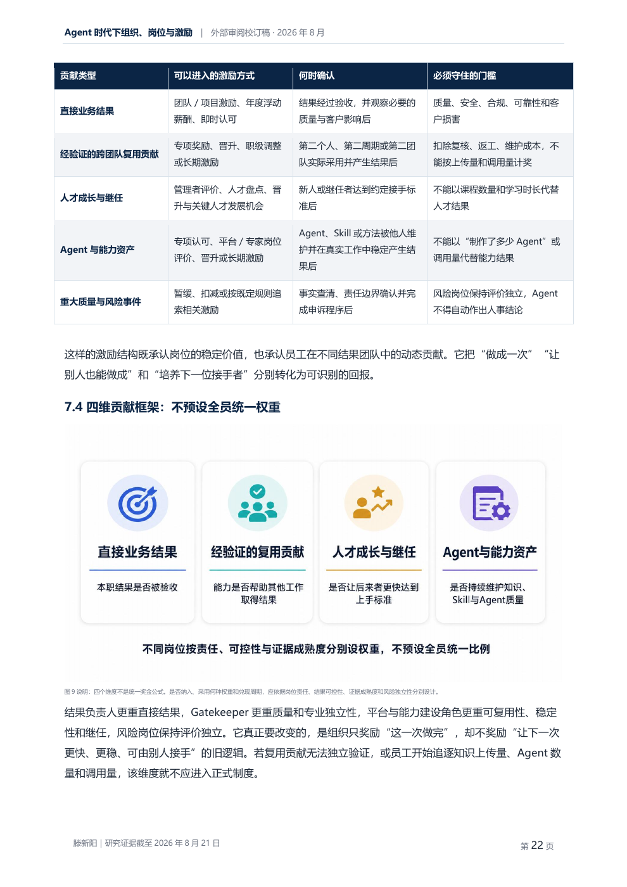

</details>

```text
Agent 时代下组织、岗位与激励 ｜ 外部审阅校订稿 · 2026 年8 月


贡献类型         可以进入的激励方式     何时确认           必须守住的门槛

             团队／项目激励、年度浮动  结果经过验收，并观察必要的  质量、安全、合规、可靠性和客
直接业务结果
             薪酬、即时认可       质量与客户影响后       户损害

             专项奖励、晋升、职级调整  第二个人、第二周期或第二团  扣除复核、返工、维护成本，不
经验证的跨团队复用贡献
             或长期激励         队实际采用并产生结果后    能按上传量和调用量计奖

             管理者评价、人才盘点、晋  新人或继任者达到约定接手标  不能以课程数量和学习时长代替
人才成长与继任
             升与关键人才发展机会    准后             人才结果

                                                  Agent、Skill 或方法被他人维
             专项认可、平台／专家岗位                   不能以“制作了多少Agent”或
Agent 与能力资产                  护并在真实工作中稳定产生结
             评价、晋升或长期激励                   调用量代替能力结果
                           果后

             暂缓、扣减或按既定规则追  事实查清、责任边界确认并完  风险岗位保持评价独立，Agent
重大质量与风险事件
             索相关激励         成申诉程序后         不得自动作出人事结论


这样的激励结构既承认岗位的稳定价值，也承认员工在不同结果团队中的动态贡献。它把“做成一次”“让
别人也能做成”和“培养下一位接手者”分别转化为可识别的回报。

 7.4 四维贡献框架：不预设全员统一权重


 图9 说明：四个维度不是统一奖金公式。是否纳入、采用何种权重和兑现周期，应依据岗位责任、结果可控性、证据成熟度和风险独立性分别设计。

 结果负责人更重直接结果，Gatekeeper 更重质量和专业独立性，平台与能力建设角色更重可复用性、稳定
性和继任，风险岗位保持评价独立。它真正要改变的，是组织只奖励“这一次做完”，却不奖励“让下一次
更快、更稳、可由别人接手”的旧逻辑。若复用贡献无法独立验证，或员工开始追逐知识上传量、Agent 数
量和调用量，该维度就不应进入正式制度。


  滕新阳｜研究证据截至2026 年8 月21 日                                                          第 22 页
```

<a id="page-23"></a>

## 第 23 页

[打开本页原图](pages/page-23.png) · [原始 PDF，第 23 页](agent-era-organization-roles-incentives.zh-CN.pdf#page=23)

<details>
<summary>展开原页图文排版</summary>

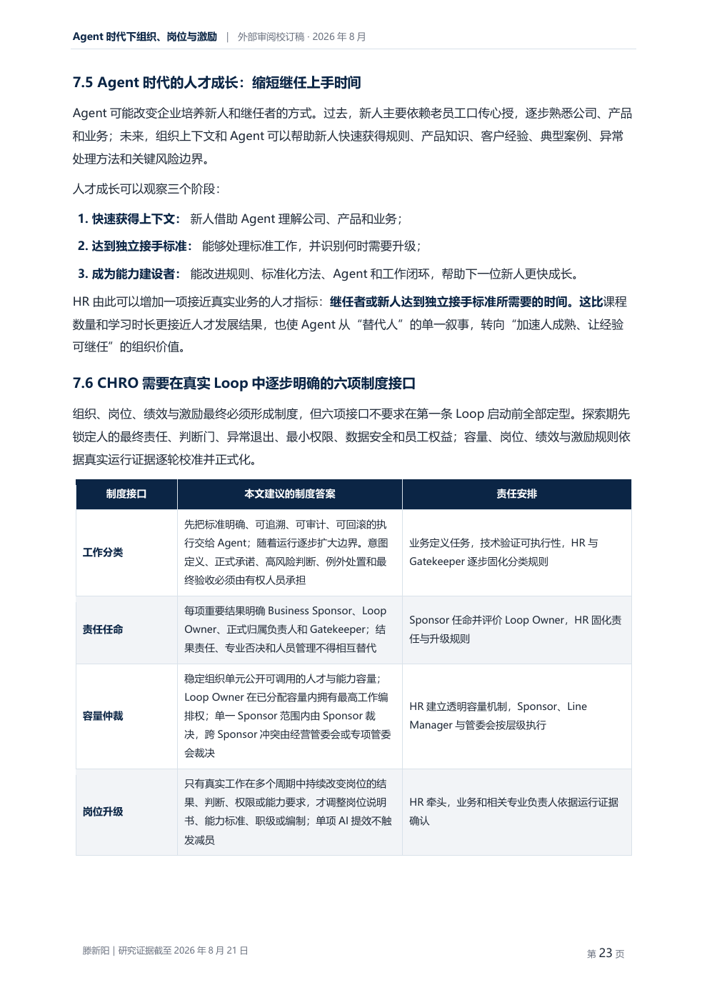

</details>

```text
Agent 时代下组织、岗位与激励 ｜ 外部审阅校订稿 · 2026 年8 月


7.5 Agent 时代的人才成长：缩短继任上手时间

Agent 可能改变企业培养新人和继任者的方式。过去，新人主要依赖老员工口传心授，逐步熟悉公司、产品
和业务；未来，组织上下文和Agent 可以帮助新人快速获得规则、产品知识、客户经验、典型案例、异常
处理方法和关键风险边界。

人才成长可以观察三个阶段：

 1. 快速获得上下文： 新人借助Agent 理解公司、产品和业务；

 2. 达到独立接手标准： 能够处理标准工作，并识别何时需要升级；

 3. 成为能力建设者： 能改进规则、标准化方法、Agent 和工作闭环，帮助下一位新人更快成长。

HR 由此可以增加一项接近真实业务的人才指标：继任者或新人达到独立接手标准所需要的时间。这比课程
数量和学习时长更接近人才发展结果，也使Agent 从“替代人”的单一叙事，转向“加速人成熟、让经验
可继任”的组织价值。

7.6 CHRO 需要在真实Loop 中逐步明确的六项制度接口

组织、岗位、绩效与激励最终必须形成制度，但六项接口不要求在第一条Loop 启动前全部定型。探索期先
锁定人的最终责任、判断门、异常退出、最小权限、数据安全和员工权益；容量、岗位、绩效与激励规则依
据真实运行证据逐轮校准并正式化。


   制度接口          本文建议的制度答案                责任安排

           先把标准明确、可追溯、可审计、可回滚的执
            行交给Agent；随着运行逐步扩大边界。意图  业务定义任务，技术验证可执行性，HR 与
 工作分类
           定义、正式承诺、高风险判断、例外处置和最    Gatekeeper 逐步固化分类规则
           终验收必须由有权人员承担

              每项重要结果明确Business Sponsor、Loop
                                                           Sponsor 任命并评价Loop Owner，HR 固化责
 责任任命        Owner、正式归属负责人和Gatekeeper；结
                                 任与升级规则
           果责任、专业否决和人员管理不得相互替代

           稳定组织单元公开可调用的人才与能力容量；
                  Loop Owner 在已分配容量内拥有最高工作编
                                               HR 建立透明容量机制，Sponsor、Line
 容量仲裁        排权；单一Sponsor 范围内由Sponsor 裁
                                                       Manager 与管委会按层级执行
               决，跨Sponsor 冲突由经营管委会或专项管委
           会裁决

           只有真实工作在多个周期中持续改变岗位的结
           果、判断、权限或能力要求，才调整岗位说明   HR 牵头，业务和相关专业负责人依据运行证据
 岗位升级
            书、能力标准、职级或编制；单项AI 提效不触  确认
           发减员


 滕新阳｜研究证据截至2026 年8 月21 日                                                         第 23 页
```

<a id="page-24"></a>

## 第 24 页

[打开本页原图](pages/page-24.png) · [原始 PDF，第 24 页](agent-era-organization-roles-incentives.zh-CN.pdf#page=24)

<details>
<summary>展开原页图文排版</summary>

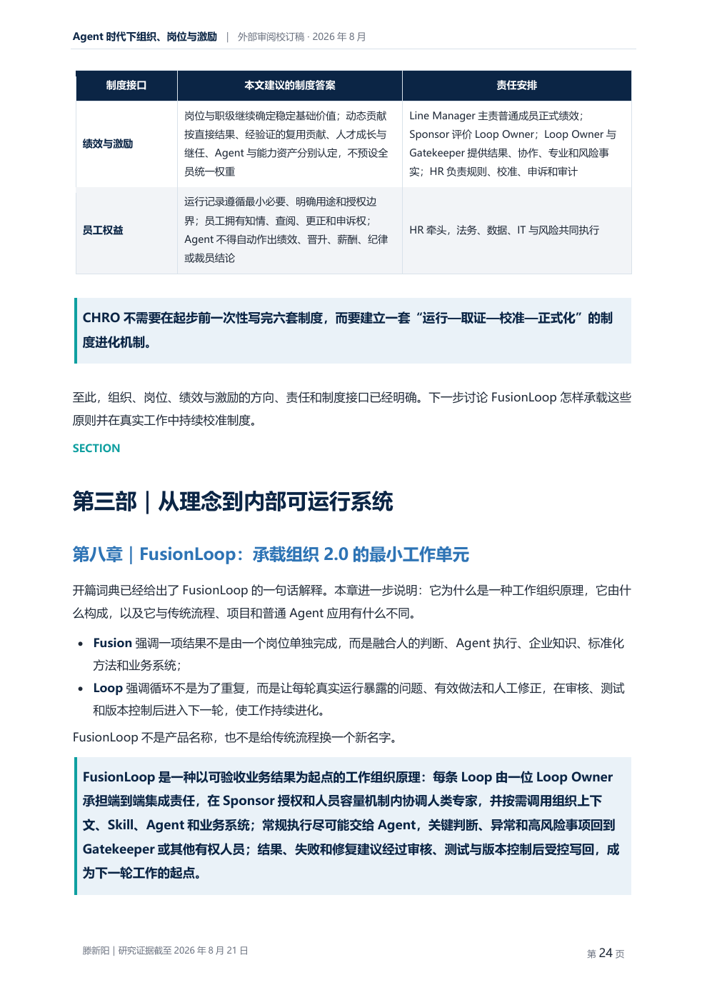

</details>

```text
Agent 时代下组织、岗位与激励 ｜ 外部审阅校订稿 · 2026 年8 月


   制度接口          本文建议的制度答案                责任安排

           岗位与职级继续确定稳定基础价值；动态贡献     Line Manager 主责普通成员正式绩效；
           按直接结果、经验证的复用贡献、人才成长与    Sponsor 评价Loop Owner；Loop Owner 与
 绩效与激励
               继任、Agent 与能力资产分别认定，不预设全    Gatekeeper 提供结果、协作、专业和风险事
           员统一权重                    实；HR 负责规则、校准、申诉和审计

           运行记录遵循最小必要、明确用途和授权边
           界；员工拥有知情、查阅、更正和申诉权；
 员工权益                                        HR 牵头，法务、数据、IT 与风险共同执行
                   Agent 不得自动作出绩效、晋升、薪酬、纪律
           或裁员结论


 CHRO 不需要在起步前一次性写完六套制度，而要建立一套“运行—取证—校准—正式化”的制
 度进化机制。


至此，组织、岗位、绩效与激励的方向、责任和制度接口已经明确。下一步讨论FusionLoop 怎样承载这些
原则并在真实工作中持续校准制度。

SECTION

第三部｜从理念到内部可运行系统

第八章｜FusionLoop：承载组织2.0 的最小工作单元

开篇词典已经给出了FusionLoop 的一句话解释。本章进一步说明：它为什么是一种工作组织原理，它由什
么构成，以及它与传统流程、项目和普通Agent 应用有什么不同。

 •  Fusion 强调一项结果不是由一个岗位单独完成，而是融合人的判断、Agent 执行、企业知识、标准化
  方法和业务系统；
 • Loop 强调循环不是为了重复，而是让每轮真实运行暴露的问题、有效做法和人工修正，在审核、测试
  和版本控制后进入下一轮，使工作持续进化。

FusionLoop 不是产品名称，也不是给传统流程换一个新名字。

 FusionLoop 是一种以可验收业务结果为起点的工作组织原理：每条Loop 由一位Loop Owner
 承担端到端集成责任，在Sponsor 授权和人员容量机制内协调人类专家，并按需调用组织上下
 文、Skill、Agent 和业务系统；常规执行尽可能交给Agent，关键判断、异常和高风险事项回到
 Gatekeeper 或其他有权人员；结果、失败和修复建议经过审核、测试与版本控制后受控写回，成
 为下一轮工作的起点。


 滕新阳｜研究证据截至2026 年8 月21 日                                                         第 24 页
```

<a id="page-25"></a>

## 第 25 页

[打开本页原图](pages/page-25.png) · [原始 PDF，第 25 页](agent-era-organization-roles-incentives.zh-CN.pdf#page=25)

<details>
<summary>展开原页图文排版</summary>

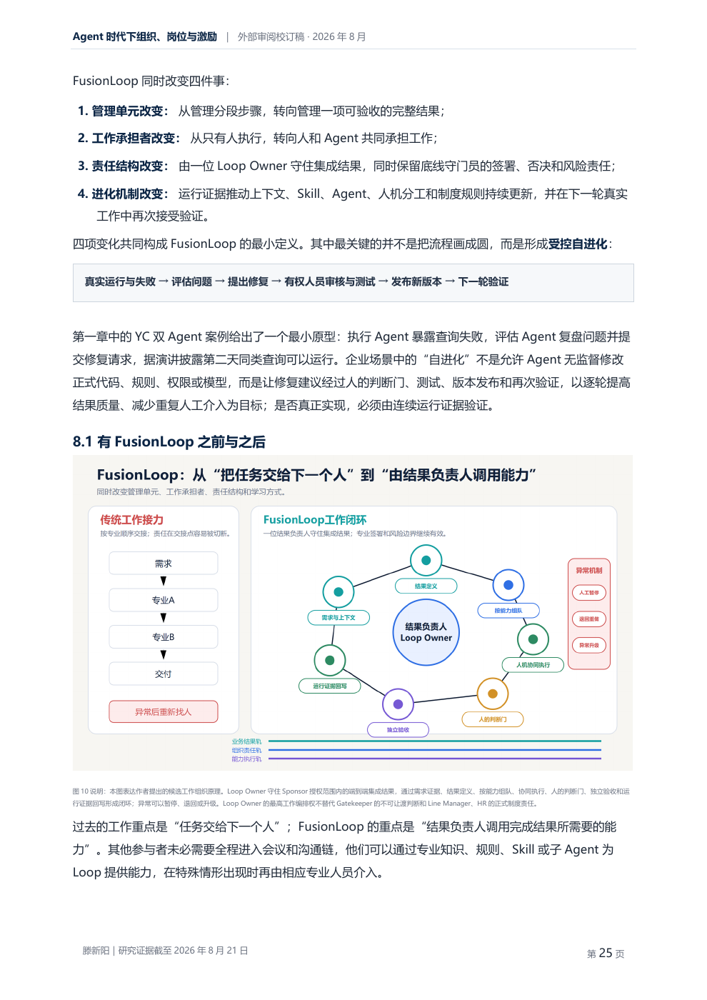

</details>

```text
Agent 时代下组织、岗位与激励 ｜ 外部审阅校订稿 · 2026 年8 月


FusionLoop 同时改变四件事：

 1. 管理单元改变： 从管理分段步骤，转向管理一项可验收的完整结果；

 2. 工作承担者改变： 从只有人执行，转向人和Agent 共同承担工作；

 3. 责任结构改变： 由一位Loop Owner 守住集成结果，同时保留底线守门员的签署、否决和风险责任；

 4. 进化机制改变： 运行证据推动上下文、Skill、Agent、人机分工和制度规则持续更新，并在下一轮真实
  工作中再次接受验证。

四项变化共同构成FusionLoop 的最小定义。其中最关键的并不是把流程画成圆，而是形成受控自进化：


 真实运行与失败 → 评估问题 → 提出修复 → 有权人员审核与测试 → 发布新版本 → 下一轮验证


第一章中的YC 双Agent 案例给出了一个最小原型：执行Agent 暴露查询失败，评估Agent 复盘问题并提
交修复请求，据演讲披露第二天同类查询可以运行。企业场景中的“自进化”不是允许Agent 无监督修改
正式代码、规则、权限或模型，而是让修复建议经过人的判断门、测试、版本发布和再次验证，以逐轮提高
结果质量、减少重复人工介入为目标；是否真正实现，必须由连续运行证据验证。

8.1 有FusionLoop 之前与之后


图10 说明：本图表达作者提出的候选工作组织原理。Loop Owner 守住Sponsor 授权范围内的端到端集成结果，通过需求证据、结果定义、按能力组队、协同执行、人的判断门、独立验收和运
行证据回写形成闭环；异常可以暂停、退回或升级。Loop Owner 的最高工作编排权不替代Gatekeeper 的不可让渡判断和Line Manager、HR 的正式制度责任。

过去的工作重点是“任务交给下一个人”；FusionLoop 的重点是“结果负责人调用完成结果所需要的能
力”。其他参与者未必需要全程进入会议和沟通链，他们可以通过专业知识、规则、Skill 或子Agent 为
Loop 提供能力，在特殊情形出现时再由相应专业人员介入。


 滕新阳｜研究证据截至2026 年8 月21 日                                                         第 25 页
```

<a id="page-26"></a>

## 第 26 页

[打开本页原图](pages/page-26.png) · [原始 PDF，第 26 页](agent-era-organization-roles-incentives.zh-CN.pdf#page=26)

<details>
<summary>展开原页图文排版</summary>

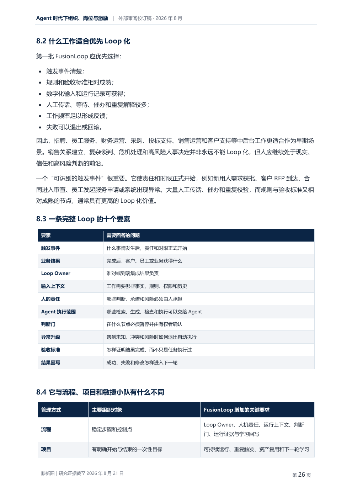

</details>

```text
Agent 时代下组织、岗位与激励 ｜ 外部审阅校订稿 · 2026 年8 月


8.2 什么工作适合优先Loop 化

第一批FusionLoop 应优先选择：

 • 触发事件清楚；
 • 规则和验收标准相对成熟；
 • 数字化输入和运行记录可获得；
 • 人工传话、等待、催办和重复解释较多；
 • 工作频率足以形成反馈；
 • 失败可以退出或回滚。

因此，招聘、员工服务、财务运营、采购、投标支持、销售运营和客户支持等中后台工作更适合作为早期场
景。销售关系建立、复杂谈判、危机处理和高风险人事决定并非永远不能Loop 化，但人应继续处于现实、
信任和高风险判断的前沿。

一个“可识别的触发事件”很重要。它使责任和时限正式开始，例如新用人需求获批、客户RFP 到达、合
同进入审查、员工发起服务申请或系统出现异常。大量人工传话、催办和重复校验，而规则与验收标准又相
对成熟的节点，通常具有更高的Loop 化价值。

8.3 一条完整Loop 的十个要素

 要素            需要回答的问题

 触发事件          什么事情发生后，责任和时限正式开始

 业务结果          完成后，客户、员工或业务获得什么

  Loop Owner        谁对端到端集成结果负责

 输入上下文         工作需要哪些事实、规则、权限和历史

 人的责任          哪些判断、承诺和风险必须由人承担

  Agent 执行范围       哪些检索、生成、检查和执行可以交给Agent

 判断门           在什么节点必须暂停并由有权者确认

 异常升级          遇到未知、冲突和风险时如何退出自动执行

 验收标准          怎样证明结果完成，而不只是任务执行过

 结果回写          成功、失败和修改怎样进入下一轮


8.4 它与流程、项目和敏捷小队有什么不同

 管理方式      主要组织对象                            FusionLoop 增加的关键要求

                                                       Loop Owner、人机责任、运行上下文、判断
 流程        稳定步骤和控制点
                                 门、运行证据与学习回写

 项目        有明确开始与结束的一次性目标        可持续运行、重复触发、资产复用和下一轮学习


 滕新阳｜研究证据截至2026 年8 月21 日                                                         第 26 页
```

<a id="page-27"></a>

## 第 27 页

[打开本页原图](pages/page-27.png) · [原始 PDF，第 27 页](agent-era-organization-roles-incentives.zh-CN.pdf#page=27)

<details>
<summary>展开原页图文排版</summary>

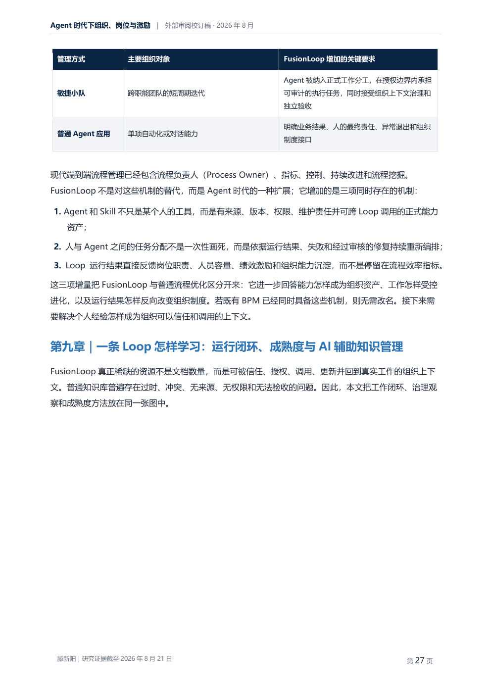

</details>

```text
Agent 时代下组织、岗位与激励 ｜ 外部审阅校订稿 · 2026 年8 月


 管理方式      主要组织对象                            FusionLoop 增加的关键要求

                                                          Agent 被纳入正式工作分工，在授权边界内承担
 敏捷小队      跨职能团队的短周期迭代           可审计的执行任务，同时接受组织上下文治理和
                                 独立验收

                                 明确业务结果、人的最终责任、异常退出和组织
 普通Agent 应用   单项自动化或对话能力
                                 制度接口


现代端到端流程管理已经包含流程负责人（Process Owner）、指标、控制、持续改进和流程挖掘。
FusionLoop 不是对这些机制的替代，而是Agent 时代的一种扩展；它增加的是三项同时存在的机制：

 1. Agent 和Skill 不只是某个人的工具，而是有来源、版本、权限、维护责任并可跨Loop 调用的正式能力
  资产；

 2. 人与Agent 之间的任务分配不是一次性画死，而是依据运行结果、失败和经过审核的修复持续重新编排；

 3. Loop 运行结果直接反馈岗位职责、人员容量、绩效激励和组织能力沉淀，而不是停留在流程效率指标。

这三项增量把FusionLoop 与普通流程优化区分开来：它进一步回答能力怎样成为组织资产、工作怎样受控
进化，以及运行结果怎样反向改变组织制度。若既有BPM 已经同时具备这些机制，则无需改名。接下来需
要解决个人经验怎样成为组织可以信任和调用的上下文。

第九章｜一条Loop 怎样学习：运行闭环、成熟度与AI 辅助知识管理

FusionLoop 真正稀缺的资源不是文档数量，而是可被信任、授权、调用、更新并回到真实工作的组织上下
文。普通知识库普遍存在过时、冲突、无来源、无权限和无法验收的问题。因此，本文把工作闭环、治理观
察和成熟度方法放在同一张图中。


 滕新阳｜研究证据截至2026 年8 月21 日                                                         第 27 页
```

<a id="page-28"></a>

## 第 28 页

[打开本页原图](pages/page-28.png) · [原始 PDF，第 28 页](agent-era-organization-roles-incentives.zh-CN.pdf#page=28)

<details>
<summary>展开原页图文排版</summary>

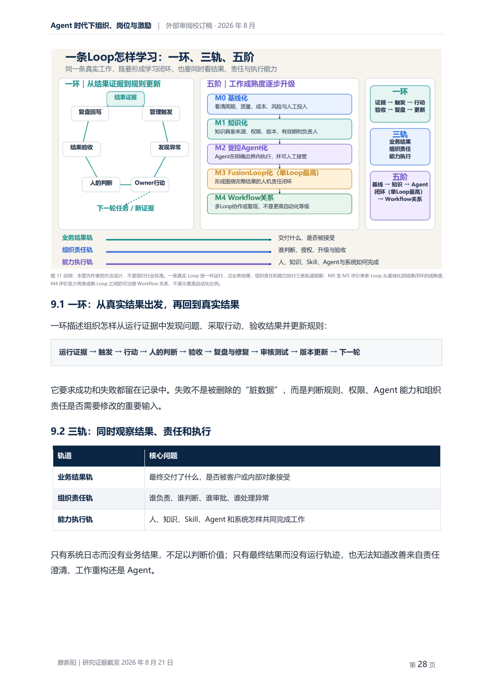

</details>

```text
Agent 时代下组织、岗位与激励 ｜ 外部审阅校订稿 · 2026 年8 月


图11 说明：本图为作者的方法设计，不是现行行业标准。一条真实Loop 按一环运行，沿业务结果、组织责任和能力执行三条轨道观察；M0 至M3 评价单条Loop 从基线化到结果闭环的成熟度，
M4 评价至少两条成熟Loop 之间的可治理Workflow 关系，不表示更高自动化比例。

9.1 一环：从真实结果出发，再回到真实结果

一环描述组织怎样从运行证据中发现问题、采取行动、验收结果并更新规则：


 运行证据 → 触发 → 行动 → 人的判断 → 验收 → 复盘与修复 → 审核测试 → 版本更新 → 下一轮


它要求成功和失败都留在记录中。失败不是被删除的“脏数据”，而是判断规则、权限、Agent 能力和组织
责任是否需要修改的重要输入。

9.2 三轨：同时观察结果、责任和执行

 轨道           核心问题

 业务结果轨        最终交付了什么，是否被客户或内部对象接受

 组织责任轨        谁负责、谁判断、谁审批、谁处理异常

 能力执行轨            人、知识、Skill、Agent 和系统怎样共同完成工作


只有系统日志而没有业务结果，不足以判断价值；只有最终结果而没有运行轨迹，也无法知道改善来自责任
澄清、工作重构还是Agent。


 滕新阳｜研究证据截至2026 年8 月21 日                                                         第 28 页
```

<a id="page-29"></a>

## 第 29 页

[打开本页原图](pages/page-29.png) · [原始 PDF，第 29 页](agent-era-organization-roles-incentives.zh-CN.pdf#page=29)

<details>
<summary>展开原页图文排版</summary>

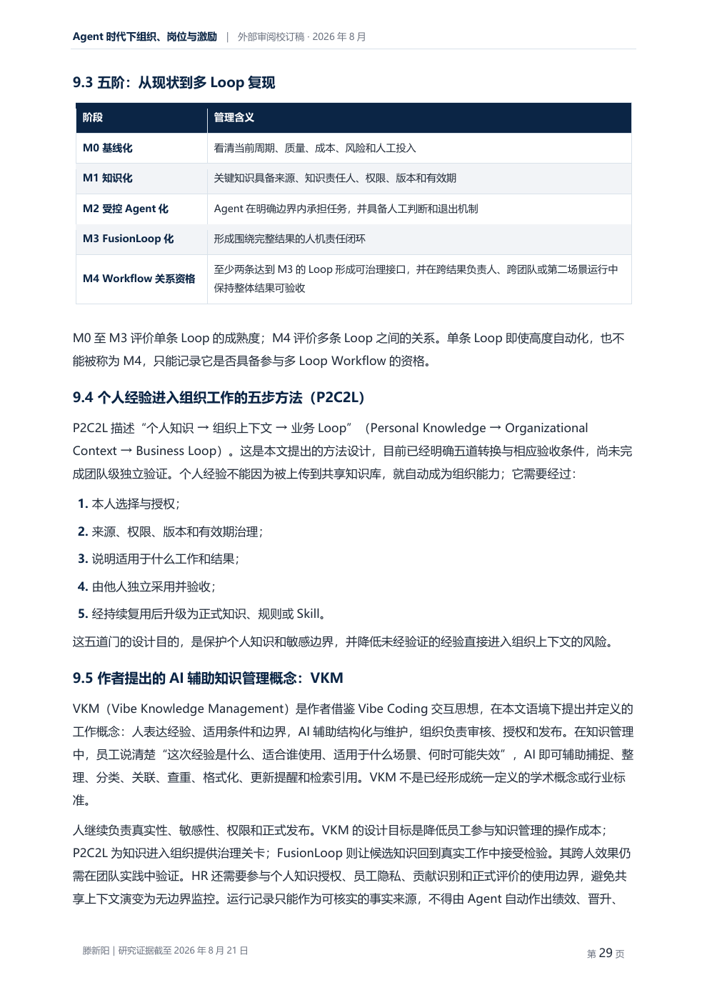

</details>

```text
Agent 时代下组织、岗位与激励 ｜ 外部审阅校订稿 · 2026 年8 月


9.3 五阶：从现状到多Loop 复现

 阶段           管理含义

 M0 基线化        看清当前周期、质量、成本、风险和人工投入

 M1 知识化        关键知识具备来源、知识责任人、权限、版本和有效期

 M2 受控Agent 化        Agent 在明确边界内承担任务，并具备人工判断和退出机制

 M3 FusionLoop 化    形成围绕完整结果的人机责任闭环

              至少两条达到M3 的Loop 形成可治理接口，并在跨结果负责人、跨团队或第二场景运行中
 M4 Workflow 关系资格
              保持整体结果可验收


M0 至M3 评价单条Loop 的成熟度；M4 评价多条Loop 之间的关系。单条Loop 即使高度自动化，也不
能被称为M4，只能记录它是否具备参与多Loop Workflow 的资格。

9.4 个人经验进入组织工作的五步方法（P2C2L）

P2C2L 描述“个人知识 → 组织上下文 → 业务Loop”（Personal Knowledge → Organizational
Context → Business Loop）。这是本文提出的方法设计，目前已经明确五道转换与相应验收条件，尚未完
成团队级独立验证。个人经验不能因为被上传到共享知识库，就自动成为组织能力；它需要经过：

 1. 本人选择与授权；

 2. 来源、权限、版本和有效期治理；

 3. 说明适用于什么工作和结果；

 4. 由他人独立采用并验收；

 5. 经持续复用后升级为正式知识、规则或Skill。

这五道门的设计目的，是保护个人知识和敏感边界，并降低未经验证的经验直接进入组织上下文的风险。

9.5 作者提出的AI 辅助知识管理概念：VKM

VKM（Vibe Knowledge Management）是作者借鉴Vibe Coding 交互思想，在本文语境下提出并定义的
工作概念：人表达经验、适用条件和边界，AI 辅助结构化与维护，组织负责审核、授权和发布。在知识管理
中，员工说清楚“这次经验是什么、适合谁使用、适用于什么场景、何时可能失效”，AI 即可辅助捕捉、整
理、分类、关联、查重、格式化、更新提醒和检索引用。VKM 不是已经形成统一定义的学术概念或行业标
准。

人继续负责真实性、敏感性、权限和正式发布。VKM 的设计目标是降低员工参与知识管理的操作成本；
P2C2L 为知识进入组织提供治理关卡；FusionLoop 则让候选知识回到真实工作中接受检验。其跨人效果仍
需在团队实践中验证。HR 还需要参与个人知识授权、员工隐私、贡献识别和正式评价的使用边界，避免共
享上下文演变为无边界监控。运行记录只能作为可核实的事实来源，不得由Agent 自动作出绩效、晋升、


 滕新阳｜研究证据截至2026 年8 月21 日                                                         第 29 页
```

<a id="page-30"></a>

## 第 30 页

[打开本页原图](pages/page-30.png) · [原始 PDF，第 30 页](agent-era-organization-roles-incentives.zh-CN.pdf#page=30)

<details>
<summary>展开原页图文排版</summary>

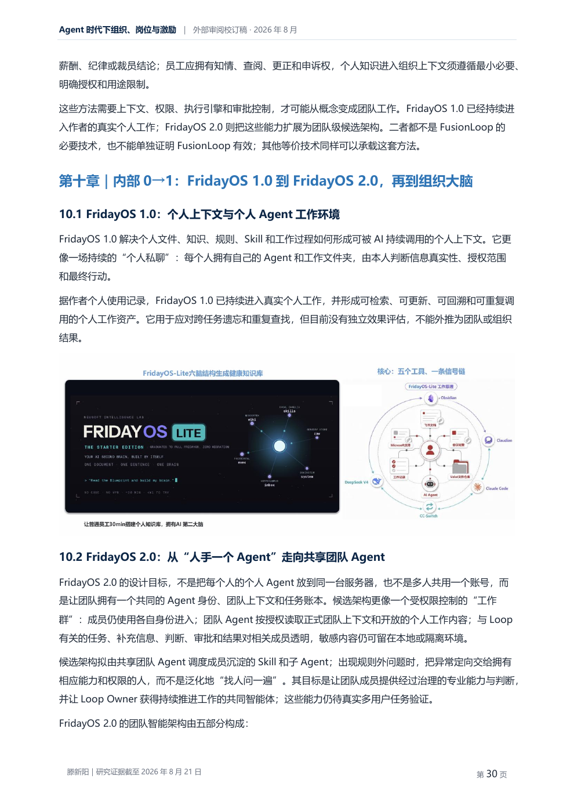

</details>

```text
Agent 时代下组织、岗位与激励 ｜ 外部审阅校订稿 · 2026 年8 月


薪酬、纪律或裁员结论；员工应拥有知情、查阅、更正和申诉权，个人知识进入组织上下文须遵循最小必要、
明确授权和用途限制。

这些方法需要上下文、权限、执行引擎和审批控制，才可能从概念变成团队工作。FridayOS 1.0 已经持续进
入作者的真实个人工作；FridayOS 2.0 则把这些能力扩展为团队级候选架构。二者都不是FusionLoop 的
必要技术，也不能单独证明FusionLoop 有效；其他等价技术同样可以承载这套方法。

第十章｜内部0→1：FridayOS 1.0 到FridayOS 2.0，再到组织大脑

10.1 FridayOS 1.0：个人上下文与个人Agent 工作环境

FridayOS 1.0 解决个人文件、知识、规则、Skill 和工作过程如何形成可被AI 持续调用的个人上下文。它更
像一场持续的“个人私聊”：每个人拥有自己的Agent 和工作文件夹，由本人判断信息真实性、授权范围
和最终行动。

据作者个人使用记录，FridayOS 1.0 已持续进入真实个人工作，并形成可检索、可更新、可回溯和可重复调
用的个人工作资产。它用于应对跨任务遗忘和重复查找，但目前没有独立效果评估，不能外推为团队或组织
结果。


10.2 FridayOS 2.0：从“人手一个Agent”走向共享团队Agent

FridayOS 2.0 的设计目标，不是把每个人的个人Agent 放到同一台服务器，也不是多人共用一个账号，而
是让团队拥有一个共同的Agent 身份、团队上下文和任务账本。候选架构更像一个受权限控制的“工作
群”：成员仍使用各自身份进入；团队Agent 按授权读取正式团队上下文和开放的个人工作内容；与Loop
有关的任务、补充信息、判断、审批和结果对相关成员透明，敏感内容仍可留在本地或隔离环境。

候选架构拟由共享团队Agent 调度成员沉淀的Skill 和子Agent；出现规则外问题时，把异常定向交给拥有
相应能力和权限的人，而不是泛化地“找人问一遍”。其目标是让团队成员提供经过治理的专业能力与判断，
并让Loop Owner 获得持续推进工作的共同智能体；这些能力仍待真实多用户任务验证。

FridayOS 2.0 的团队智能架构由五部分构成：


 滕新阳｜研究证据截至2026 年8 月21 日                                                         第 30 页
```

<a id="page-31"></a>

## 第 31 页

[打开本页原图](pages/page-31.png) · [原始 PDF，第 31 页](agent-era-organization-roles-incentives.zh-CN.pdf#page=31)

<details>
<summary>展开原页图文排版</summary>

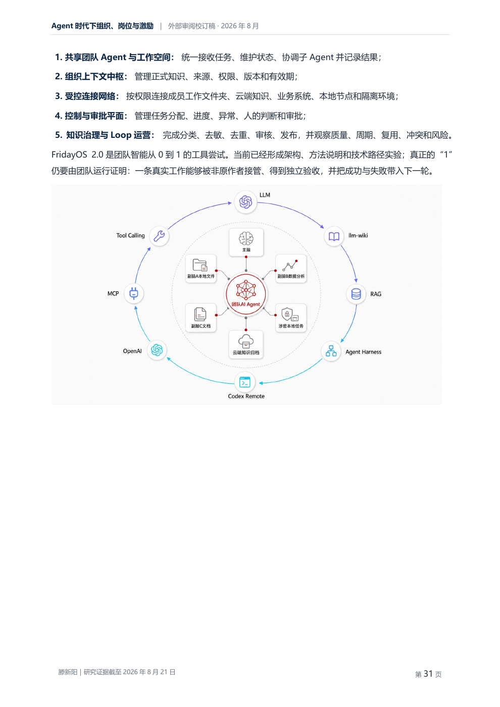

</details>

```text
Agent 时代下组织、岗位与激励 ｜ 外部审阅校订稿 · 2026 年8 月


 1. 共享团队Agent 与工作空间： 统一接收任务、维护状态、协调子Agent 并记录结果；

 2. 组织上下文中枢： 管理正式知识、来源、权限、版本和有效期；

 3. 受控连接网络： 按权限连接成员工作文件夹、云端知识、业务系统、本地节点和隔离环境；

 4. 控制与审批平面： 管理任务分配、进度、异常、人的判断和审批；

 5. 知识治理与Loop 运营： 完成分类、去敏、去重、审核、发布，并观察质量、周期、复用、冲突和风险。

FridayOS 2.0 是团队智能从0 到1 的工具尝试。当前已经形成架构、方法说明和技术路径实验；真正的“1”
仍要由团队运行证明：一条真实工作能够被非原作者接管、得到独立验收，并把成功与失败带入下一轮。


 滕新阳｜研究证据截至2026 年8 月21 日                                                         第 31 页
```

<a id="page-32"></a>

## 第 32 页

[打开本页原图](pages/page-32.png) · [原始 PDF，第 32 页](agent-era-organization-roles-incentives.zh-CN.pdf#page=32)

<details>
<summary>展开原页图文排版</summary>

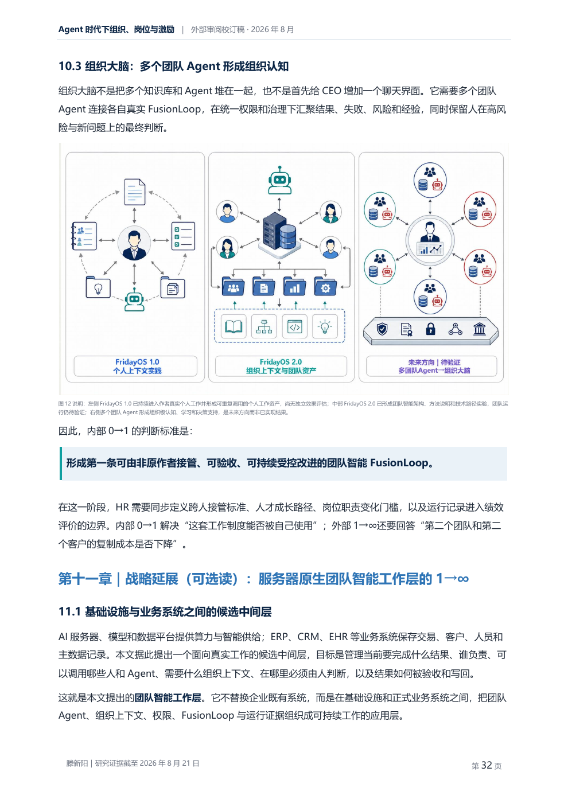

</details>

```text
Agent 时代下组织、岗位与激励 ｜ 外部审阅校订稿 · 2026 年8 月


10.3 组织大脑：多个团队Agent 形成组织认知

组织大脑不是把多个知识库和Agent 堆在一起，也不是首先给CEO 增加一个聊天界面。它需要多个团队
Agent 连接各自真实FusionLoop，在统一权限和治理下汇聚结果、失败、风险和经验，同时保留人在高风
险与新问题上的最终判断。


图12 说明：左侧FridayOS 1.0 已持续进入作者真实个人工作并形成可重复调用的个人工作资产，尚无独立效果评估；中部FridayOS 2.0 已形成团队智能架构、方法说明和技术路径实验，团队运
行仍待验证；右侧多个团队Agent 形成组织级认知、学习和决策支持，是未来方向而非已实现结果。

因此，内部0→1 的判断标准是：

 形成第一条可由非原作者接管、可验收、可持续受控改进的团队智能 FusionLoop。


在这一阶段，HR 需要同步定义跨人接管标准、人才成长路径、岗位职责变化门槛，以及运行记录进入绩效
评价的边界。内部0→1 解决“这套工作制度能否被自己使用”；外部1→∞还要回答“第二个团队和第二
个客户的复制成本是否下降”。

第十一章｜战略延展（可选读）：服务器原生团队智能工作层的1→∞

11.1 基础设施与业务系统之间的候选中间层

AI 服务器、模型和数据平台提供算力与智能供给；ERP、CRM、EHR 等业务系统保存交易、客户、人员和
主数据记录。本文据此提出一个面向真实工作的候选中间层，目标是管理当前要完成什么结果、谁负责、可
以调用哪些人和Agent、需要什么组织上下文、在哪里必须由人判断，以及结果如何被验收和写回。

这就是本文提出的团队智能工作层。它不替换企业既有系统，而是在基础设施和正式业务系统之间，把团队
Agent、组织上下文、权限、FusionLoop 与运行证据组织成可持续工作的应用层。


 滕新阳｜研究证据截至2026 年8 月21 日                                                         第 32 页
```

<a id="page-33"></a>

## 第 33 页

[打开本页原图](pages/page-33.png) · [原始 PDF，第 33 页](agent-era-organization-roles-incentives.zh-CN.pdf#page=33)

<details>
<summary>展开原页图文排版</summary>

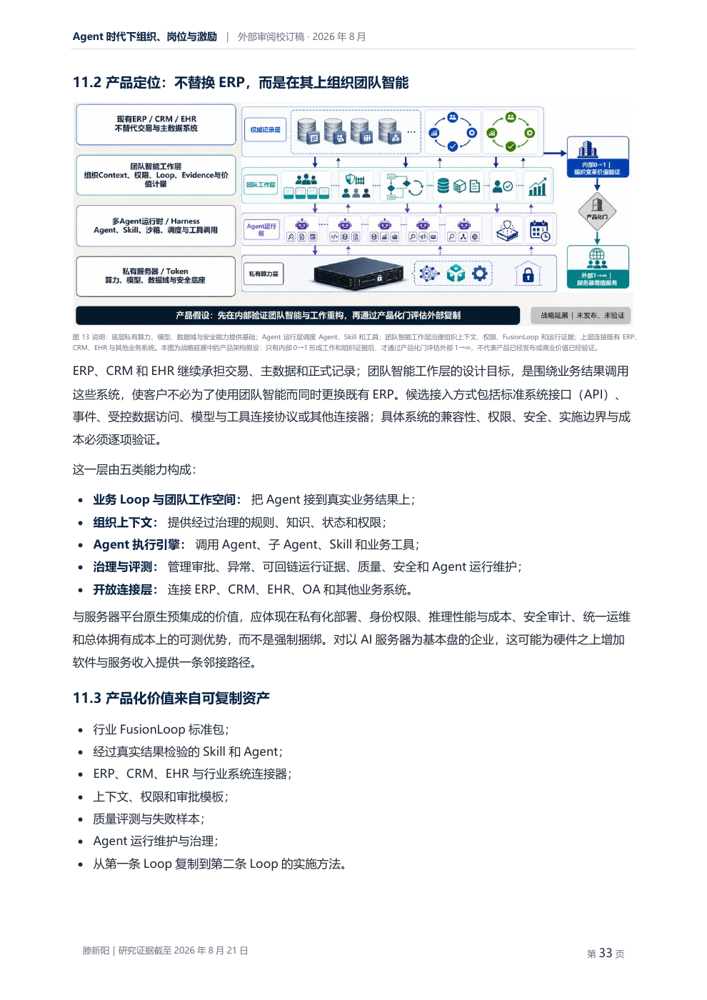

</details>

```text
Agent 时代下组织、岗位与激励 ｜ 外部审阅校订稿 · 2026 年8 月


11.2 产品定位：不替换ERP，而是在其上组织团队智能


图13 说明：底层私有算力、模型、数据域与安全能力提供基础；Agent 运行层调度Agent、Skill 和工具；团队智能工作层治理组织上下文、权限、FusionLoop 和运行证据；上层连接既有ERP、
CRM、EHR 与其他业务系统。本图为战略延展中的产品架构假设：只有内部0→1 形成工作和组织证据后，才通过产品化门评估外部1→∞，不代表产品已经发布或商业价值已经验证。

ERP、CRM 和EHR 继续承担交易、主数据和正式记录；团队智能工作层的设计目标，是围绕业务结果调用
这些系统，使客户不必为了使用团队智能而同时更换既有ERP。候选接入方式包括标准系统接口（API）、
事件、受控数据访问、模型与工具连接协议或其他连接器；具体系统的兼容性、权限、安全、实施边界与成
本必须逐项验证。

这一层由五类能力构成：

 • 业务Loop 与团队工作空间： 把Agent 接到真实业务结果上；
 • 组织上下文： 提供经过治理的规则、知识、状态和权限；
 • Agent 执行引擎： 调用Agent、子Agent、Skill 和业务工具；
 • 治理与评测： 管理审批、异常、可回链运行证据、质量、安全和Agent 运行维护；
 • 开放连接层： 连接ERP、CRM、EHR、OA 和其他业务系统。

与服务器平台原生预集成的价值，应体现在私有化部署、身份权限、推理性能与成本、安全审计、统一运维
和总体拥有成本上的可测优势，而不是强制捆绑。对以AI 服务器为基本盘的企业，这可能为硬件之上增加
软件与服务收入提供一条邻接路径。

11.3 产品化价值来自可复制资产

 • 行业FusionLoop 标准包；
 • 经过真实结果检验的Skill 和Agent；
 • ERP、CRM、EHR 与行业系统连接器；
 • 上下文、权限和审批模板；
 • 质量评测与失败样本；
 • Agent 运行维护与治理；
 • 从第一条Loop 复制到第二条Loop 的实施方法。


 滕新阳｜研究证据截至2026 年8 月21 日                                                         第 33 页
```

<a id="page-34"></a>

## 第 34 页

[打开本页原图](pages/page-34.png) · [原始 PDF，第 34 页](agent-era-organization-roles-incentives.zh-CN.pdf#page=34)

<details>
<summary>展开原页图文排版</summary>

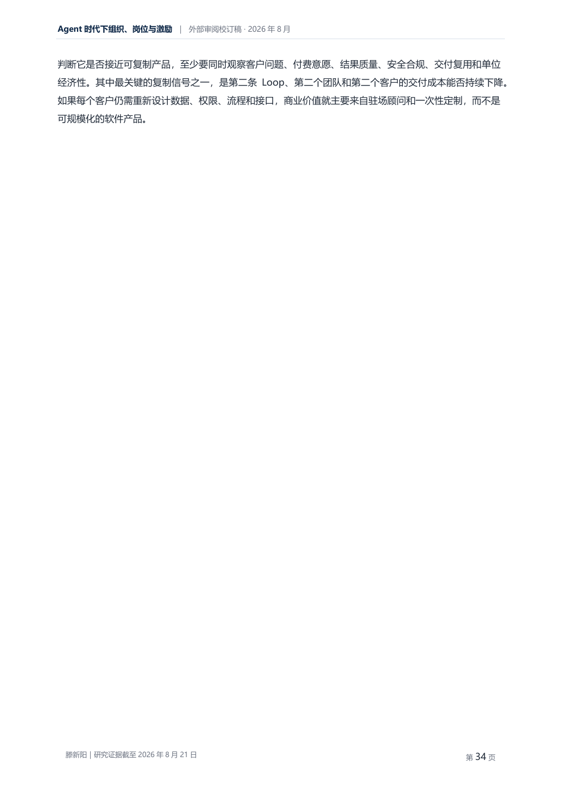

</details>

```text
Agent 时代下组织、岗位与激励 ｜ 外部审阅校订稿 · 2026 年8 月


判断它是否接近可复制产品，至少要同时观察客户问题、付费意愿、结果质量、安全合规、交付复用和单位
经济性。其中最关键的复制信号之一，是第二条Loop、第二个团队和第二个客户的交付成本能否持续下降。
如果每个客户仍需重新设计数据、权限、流程和接口，商业价值就主要来自驻场顾问和一次性定制，而不是
可规模化的软件产品。


 滕新阳｜研究证据截至2026 年8 月21 日                                                         第 34 页
```

<a id="page-35"></a>

## 第 35 页

[打开本页原图](pages/page-35.png) · [原始 PDF，第 35 页](agent-era-organization-roles-incentives.zh-CN.pdf#page=35)

<details>
<summary>展开原页图文排版</summary>

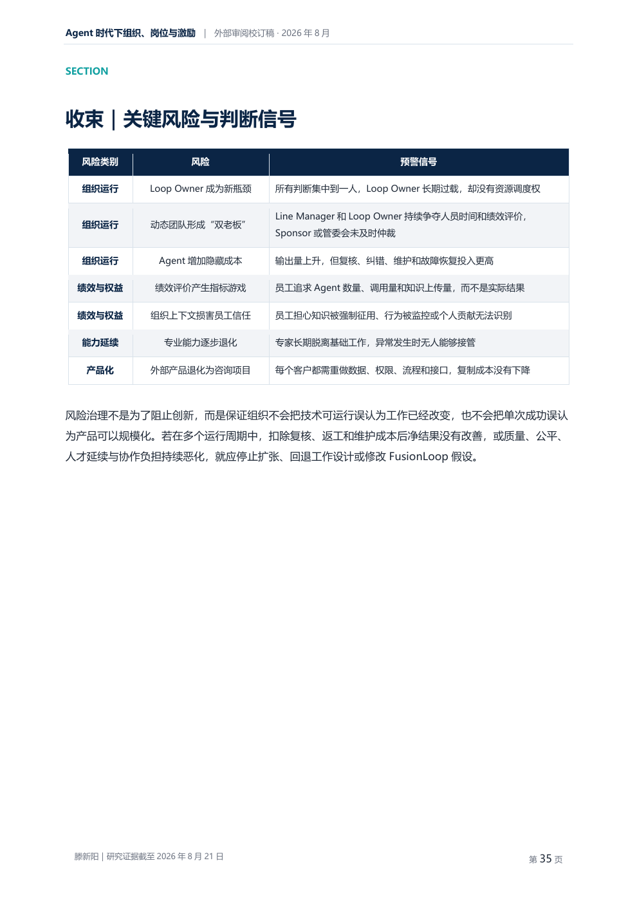

</details>

```text
Agent 时代下组织、岗位与激励 ｜ 外部审阅校订稿 · 2026 年8 月


SECTION

收束｜关键风险与判断信号


  风险类别        风险                     预警信号

  组织运行      Loop Owner 成为新瓶颈   所有判断集中到一人，Loop Owner 长期过载，却没有资源调度权

                                               Line Manager 和Loop Owner 持续争夺人员时间和绩效评价，
  组织运行    动态团队形成“双老板”
                                         Sponsor 或管委会未及时仲裁

  组织运行        Agent 增加隐藏成本    输出量上升，但复核、纠错、维护和故障恢复投入更高

 绩效与权益    绩效评价产生指标游戏    员工追求Agent 数量、调用量和知识上传量，而不是实际结果

 绩效与权益   组织上下文损害员工信任   员工担心知识被强制征用、行为被监控或个人贡献无法识别

  能力延续     专业能力逐步退化    专家长期脱离基础工作，异常发生时无人能够接管

  产品化    外部产品退化为咨询项目   每个客户都需重做数据、权限、流程和接口，复制成本没有下降


风险治理不是为了阻止创新，而是保证组织不会把技术可运行误认为工作已经改变，也不会把单次成功误认
为产品可以规模化。若在多个运行周期中，扣除复核、返工和维护成本后净结果没有改善，或质量、公平、
人才延续与协作负担持续恶化，就应停止扩张、回退工作设计或修改FusionLoop 假设。


 滕新阳｜研究证据截至2026 年8 月21 日                                                         第 35 页
```

<a id="page-36"></a>

## 第 36 页

[打开本页原图](pages/page-36.png) · [原始 PDF，第 36 页](agent-era-organization-roles-incentives.zh-CN.pdf#page=36)

<details>
<summary>展开原页图文排版</summary>

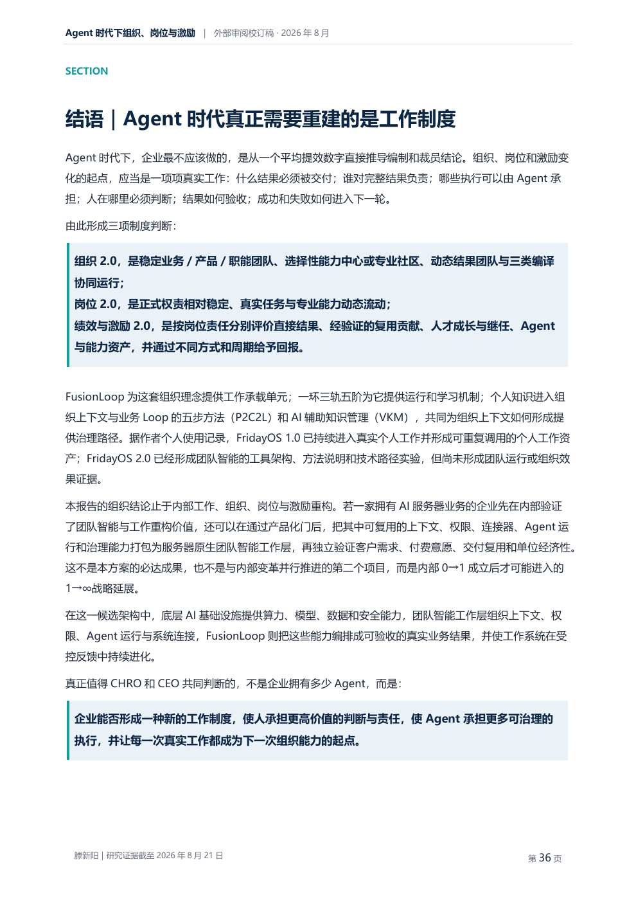

</details>

```text
Agent 时代下组织、岗位与激励 ｜ 外部审阅校订稿 · 2026 年8 月


SECTION

结语｜Agent 时代真正需要重建的是工作制度

Agent 时代下，企业最不应该做的，是从一个平均提效数字直接推导编制和裁员结论。组织、岗位和激励变
化的起点，应当是一项项真实工作：什么结果必须被交付；谁对完整结果负责；哪些执行可以由Agent 承
担；人在哪里必须判断；结果如何验收；成功和失败如何进入下一轮。

由此形成三项制度判断：

 组织2.0，是稳定业务／产品／职能团队、选择性能力中心或专业社区、动态结果团队与三类编译
 协同运行；
 岗位2.0，是正式权责相对稳定、真实任务与专业能力动态流动；
 绩效与激励2.0，是按岗位责任分别评价直接结果、经验证的复用贡献、人才成长与继任、Agent
 与能力资产，并通过不同方式和周期给予回报。


FusionLoop 为这套组织理念提供工作承载单元；一环三轨五阶为它提供运行和学习机制；个人知识进入组
织上下文与业务Loop 的五步方法（P2C2L）和AI 辅助知识管理（VKM），共同为组织上下文如何形成提
供治理路径。据作者个人使用记录，FridayOS 1.0 已持续进入真实个人工作并形成可重复调用的个人工作资
产；FridayOS 2.0 已经形成团队智能的工具架构、方法说明和技术路径实验，但尚未形成团队运行或组织效
果证据。

本报告的组织结论止于内部工作、组织、岗位与激励重构。若一家拥有AI 服务器业务的企业先在内部验证
了团队智能与工作重构价值，还可以在通过产品化门后，把其中可复用的上下文、权限、连接器、Agent 运
行和治理能力打包为服务器原生团队智能工作层，再独立验证客户需求、付费意愿、交付复用和单位经济性。
这不是本方案的必达成果，也不是与内部变革并行推进的第二个项目，而是内部0→1 成立后才可能进入的
1→∞战略延展。

在这一候选架构中，底层AI 基础设施提供算力、模型、数据和安全能力，团队智能工作层组织上下文、权
限、Agent 运行与系统连接，FusionLoop 则把这些能力编排成可验收的真实业务结果，并使工作系统在受
控反馈中持续进化。

真正值得CHRO 和CEO 共同判断的，不是企业拥有多少Agent，而是：

 企业能否形成一种新的工作制度，使人承担更高价值的判断与责任，使 Agent 承担更多可治理的
 执行，并让每一次真实工作都成为下一次组织能力的起点。


 滕新阳｜研究证据截至2026 年8 月21 日                                                         第 36 页
```

<a id="page-37"></a>

## 第 37 页

[打开本页原图](pages/page-37.png) · [原始 PDF，第 37 页](agent-era-organization-roles-incentives.zh-CN.pdf#page=37)

<details>
<summary>展开原页图文排版</summary>

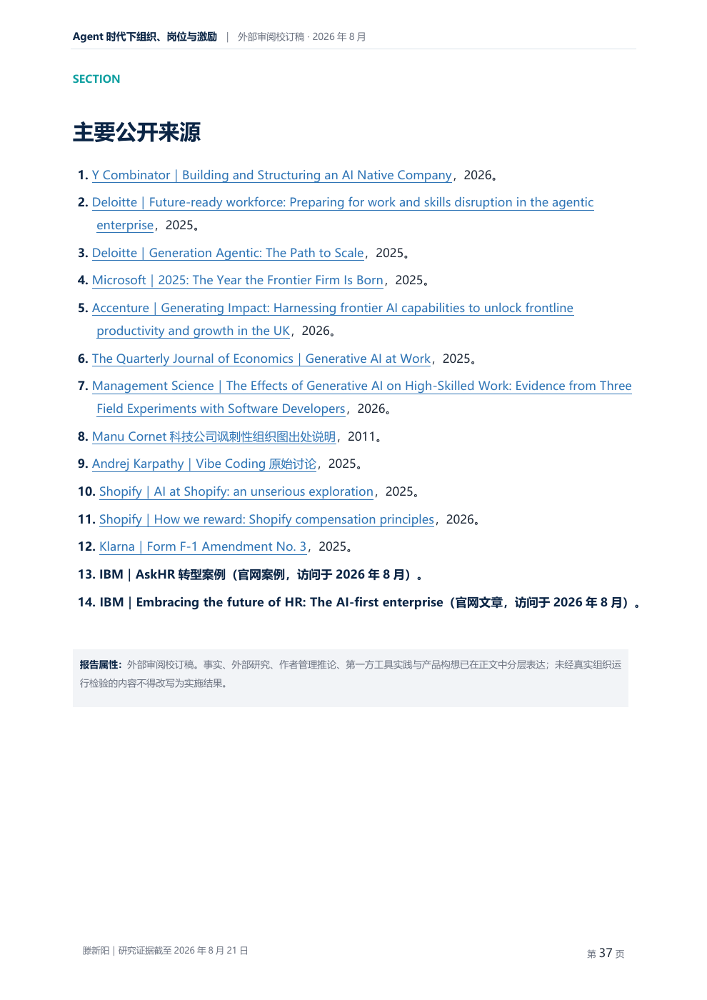

</details>

```text
Agent 时代下组织、岗位与激励 ｜ 外部审阅校订稿 · 2026 年8 月


SECTION

主要公开来源

 1. Y Combinator｜Building and Structuring an AI Native Company，2026。

 2. Deloitte｜Future-ready workforce: Preparing for work and skills disruption in the agentic
    enterprise，2025。

 3. Deloitte｜Generation Agentic: The Path to Scale，2025。

 4. Microsoft｜2025: The Year the Frontier Firm Is Born，2025。

 5. Accenture｜Generating Impact: Harnessing frontier AI capabilities to unlock frontline
    productivity and growth in the UK，2026。

 6. The Quarterly Journal of Economics｜Generative AI at Work，2025。

 7. Management Science｜The Effects of Generative AI on High-Skilled Work: Evidence from Three
    Field Experiments with Software Developers，2026。

 8. Manu Cornet 科技公司讽刺性组织图出处说明，2011。

 9. Andrej Karpathy｜Vibe Coding 原始讨论，2025。

 10. Shopify｜AI at Shopify: an unserious exploration，2025。

 11. Shopify｜How we reward: Shopify compensation principles，2026。

 12. Klarna｜Form F-1 Amendment No. 3，2025。

 13. IBM｜AskHR 转型案例（官网案例，访问于2026 年8 月）。

 14. IBM｜Embracing the future of HR: The AI-first enterprise（官网文章，访问于2026 年8 月）。


 报告属性：外部审阅校订稿。事实、外部研究、作者管理推论、第一方工具实践与产品构想已在正文中分层表达；未经真实组织运
 行检验的内容不得改写为实施结果。


 滕新阳｜研究证据截至2026 年8 月21 日                                                         第 37 页
```
