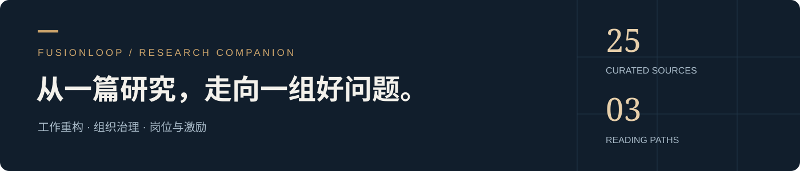

# Research Companion · 配套阅读

**围绕三个问题阅读：工作怎样重构，责任怎样重排，贡献怎样被承认。**

[**下载完整阅读包 ZIP →**](https://github.com/Owen-Teng/fusionloop/releases/download/v0.3-reading/FusionLoop-Reading-Companion-v0.3.zip) · [**阅读中文导览 PDF →**](research-companion.zh-CN.pdf) · [English](README.en.md)

25 项精选公开材料 · 3 篇中文导读 · 37 页作者论文 · 5 组双语模板

## 先选一条阅读路径

| 01 · 工作重构 | 02 · 组织治理 | 03 · 岗位与激励 |
| :--- | :--- | :--- |
| 哪些效果有证据？哪些反例不能跳过？ | 谁定结果、谁供容量、谁守住判断？ | 什么贡献值得奖励，人才如何继续成长？ |
| OECD · QJE · METR · LeadDev | Deloitte · Microsoft · Capgemini · Cisco | Deloitte · PwC · WEF · Shopify |
| [读证据与反例 →](01-evidence.md) | [读责任与协作 →](02-organization.md) | [读岗位与贡献 →](03-roles-incentives.md) |

阅读建议：先读一篇导读，再打开它链接的原报告，最后回到 [FusionLoop 原始论文](../paper/README.md) 检查哪些是外部证据，哪些仍是作者假设。

## 下载后能拿到什么

| 内容 | 阅读方式 |
| :--- | :--- |
| 作者完整研究论文 | 37 页原始 PDF，未改写 |
| 中文阅读导览 | 排版 PDF，包含三条阅读路径与完整目录 |
| 三篇主题导读 | 可检索、可做笔记的 Markdown |
| 25 项公开资料目录 | 可点击的离线网页、Markdown、CSV 与 JSON |
| METR 开发者生产率研究 | 51 页 arXiv v2 原始 PDF，按 CC BY 4.0 随包提供 |
| 五组工作模板 | 中英双语，共 10 个可填写文档 |
| 来源与完整性清单 | 逐项署名、权利说明与文件 SHA-256 |

**其余 24 项材料提供官方原文链接，全文不在 ZIP 内。** 下载解压后，打开 `START-HERE.html` 即可开始阅读；包内论文、导览、METR 原文与模板可以离线使用，官方链接需要联网。

[浏览全部 25 项资料 →](catalog.md) · [来源与许可](ATTRIBUTION.md) · [版本与下载详情](https://github.com/Owen-Teng/fusionloop/releases/tag/v0.3-reading)

## 怎样使用这些资料

外部材料分别包含实验研究、综述、调查、情景判断和企业自述。它们帮助理解问题与设计验证，不能被合并包装成 FusionLoop 已获得验证。目录是精选配套材料，不等于论文提到的完整底层资料库。原始研究的证据截止日期仍为 **2026-08-21**；本阅读包整理于 **2026-10-23**。

[返回研究首页](../README.md) · [作者主页](https://github.com/Owen-Teng)
